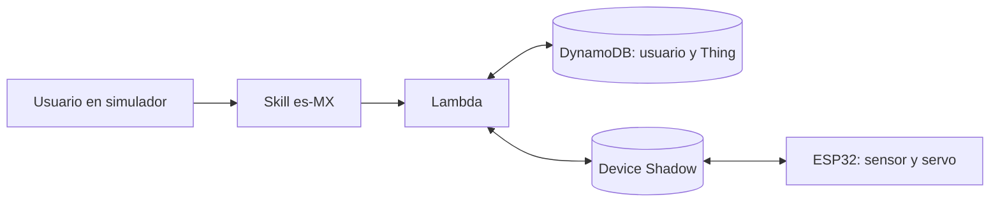

# Configuración, implementación y validación de Alexa

Registro consolidado el **9 de noviembre de 2026**, hora de Bolivia.

## 1. Función de Alexa en el sistema

La Skill proporciona la interfaz de consultas y control del tendedero. La invocación abre la conversación; los intents identifican la operación; el slot contiene el identificador del objeto. Lambda valida y resuelve ese identificador, conserva la asociación en DynamoDB y utiliza el Device Shadow del Thing vinculado.



Abrir «tendedero inteligente» no mueve la cubierta ni cambia el vínculo. «Abre la cubierta» es un intent de control separado. No se implementa cierre automático local por presencia de agua; la actuación se solicita desde Alexa a través del Shadow.

## 2. Configuración utilizada

| Elemento | Valor |
|---|---|
| Nombre de la Skill | Tendedero inteligente |
| Modelo de interacción | Custom |
| Idioma | Spanish (MX), `es-MX` |
| Nombre de invocación | `tendedero inteligente` |
| Alojamiento | Backend propio: Provision your own backend resources |
| Endpoint | AWS Lambda ARN de `tendedero-inteligente-alexa` |
| Región del backend | `us-east-2` |
| Etapa de pruebas | Development |
| Inspección de solicitudes y respuestas | Skill I/O |
| Tabla de vínculos | `tendedero_vinculaciones` |
| Thing de prueba | `tendedero-prueba2` |
| Thing físico | `tendedero-inteligente` |
| Shadow | Clásico, sin nombre |

Se utilizó el [modelo JSON incluido en el repositorio](../alexa/interaction-model-es-MX.json), con sus siete intents funcionales. Las capturas de consola también muestran intents integrados. El editor Code de Alexa-hosted no se utiliza: el código Python del backend está en [lambda_function.py](../lambda/lambda_function.py) y se despliega en AWS Lambda.

La configuración se respalda con las [figuras 01 a 07](evidencias/alexa/README.md). La conexión de la Skill al backend se comprobó mediante respuestas reales del simulador. La documentación AWS registra el trigger Alexa Skills Kit restringido al Skill ID.

## 3. Intents, slots y operación del backend

| Intent | Slot | Frase utilizada | Efecto |
|---|---|---|---|
| `VincularThingIntent` | `thing_name`: `AMAZON.SearchQuery` | vincula mi objeto con prueba dos | Validar Thing y persistir usuario → Thing. |
| `CambiarThingIntent` | `thing_name`: `AMAZON.SearchQuery` | cambia mi objeto a tendedero inteligente | Validar el nuevo Thing y reemplazar la asociación. |
| `DesvincularThingIntent` | No requerido por el handler | desvincula mi objeto | Borrar la asociación en DynamoDB. |
| `ConsultarAguaIntent` | — | hay agua en el sensor | Leer `reported.agua_detectada` del Thing vinculado. |
| `AbrirCubiertaIntent` | — | abre la cubierta | Escribir `desired.cubierta = abierta`. |
| `CerrarCubiertaIntent` | — | cierra la cubierta | Escribir `desired.cubierta = cerrada`. |
| `ConsultarCubiertaIntent` | — | cómo está la cubierta | Informar el último `reported.cubierta` y distinguir una orden diferente en `desired`. |

La apertura de la Skill genera `LaunchRequest` y devuelve un saludo. Los intents integrados de ayuda, detener, cancelar y fallback ofrecen orientación, cierre de conversación y respuesta a frases no comprendidas. El cierre de conversación no elimina el vínculo.

## 4. Vinculación y normalización de alias

El slot captura el identificador expresado por el usuario. Durante las primeras pruebas se observó que «prueba dos» llegaba como `prueba 2`. El intent era correcto, pero la variante no coincidía con el alias inicialmente configurado. Se coordinó el siguiente mapa en `THING_ALIASES_JSON`:

```json
{
  "tendedero inteligente": "tendedero-inteligente",
  "prueba dos": "tendedero-prueba2",
  "prueba 2": "tendedero-prueba2",
  "tendedero prueba dos": "tendedero-prueba2",
  "tendedero prueba 2": "tendedero-prueba2"
}
```

Lambda normaliza espacios y mayúsculas, resuelve el alias y valida existencia mediante `DescribeThing` antes de guardar el vínculo. Un identificador inexistente produce rechazo antes de reemplazar el registro.

La tabla guarda `userId`, `thingName` y `fechaVinculacion`. Cada consulta u orden resuelve el Thing mediante el usuario de la solicitud. La lectura consistente de DynamoDB permite recuperar el vínculo después de cerrar y abrir la conversación, sin depender de la memoria de una invocación Lambda.

La prueba de cambio válido muestra primero el vínculo con `tendedero-prueba2` y después la confirmación de `tendedero-inteligente`. De este modo se evidencia que la Skill no está fijada a un único Thing.

## 5. Pruebas funcionales registradas

Modalidad: **entrada textual en el simulador**. En el entorno utilizado, el micrófono no permitió realizar pruebas habladas. Esta es una condición del ensayo, no una operación funcional sin ejecutar; los resultados no se presentan como validación del reconocimiento de voz.

| ID | Escenario | Resultado | Evidencia |
|---|---|---|---|
| AX-01 | Abrir la Skill | Bienvenida y orientación de operaciones. | [08](evidencias/alexa/08-alexa-inicio.png) |
| AX-02 | Consultar sin vínculo después de desvincular | Solicita vincular primero. | [09](evidencias/alexa/09-alexa-sin-vinculo.png) |
| AX-03 | Vincular con prueba dos | Confirma `tendedero-prueba2`. | [10](evidencias/alexa/10-alexa-vinculacion.png) |
| AX-04 | Detener, volver a abrir y consultar | Conserva vínculo y responde sin nueva asociación. | [11](evidencias/alexa/11-alexa-persistencia.png) |
| AX-05 | Solicitar cambio a un Thing inexistente | Rechaza el identificador. | [12](evidencias/alexa/12-alexa-thing-inexistente.png) |
| AX-06 | Desvincular | Confirma eliminación; otra consulta sin vínculo se observa en AX-02. | [13](evidencias/alexa/13-alexa-desvinculacion.png) |
| AX-07 | Consultar clasificación seca y con agua | Respuestas negativa y afirmativa para el sensor. | [14](evidencias/alexa/14-alexa-sensor-seco-y-con-agua.png) |
| AX-08 | Consultar cubierta | Informa cubierta cerrada según el último reporte. | [14](evidencias/alexa/14-alexa-sensor-seco-y-con-agua.png) |
| AX-09 | Solicitar abrir y cerrar | Confirma envío de cada posición solicitada. | [15](evidencias/alexa/15-alexa-abrir-y-cerrar-cubierta.png) |
| AX-10 | Cambiar a un Thing válido | Reemplaza el vínculo de prueba por el Thing físico. | [16](evidencias/alexa/16-alexa-cambio-valido.png) |

El equipo confirmó la ejecución de todos los intents. Las figuras permiten inspeccionar las operaciones indicadas en la tabla; no se atribuye una captura individual a ayuda o fallback si no está incluida en este conjunto.

## 6. Integración con el dispositivo y recuperación de orden

Además de las pruebas iniciales con el Thing de prueba, el equipo confirmó el ensayo integrado con ESP32, sensor, servo, Shadows y base de datos. Se observaron consultas del sensor y control de apertura/cierre mediante el backend.

También se ensayó esta secuencia:

1. Desconectar el cable del ESP32.
2. Enviar desde Alexa una solicitud de apertura o cierre.
3. Conservar la posición solicitada en el Shadow durante la desconexión.
4. Reconectar el ESP32.
5. Observar la aplicación de la orden y la actualización de estado en AWS, sin repetir el comando.

Este resultado corresponde a recuperación tras desconexión y nuevo arranque. El firmware, al conectar MQTT, solicita el Shadow y aplica la posición deseada vigente. No se equipara ese ensayo con una pérdida aislada de Wi-Fi manteniendo el dispositivo encendido.

Las observaciones físicas de este apartado fueron comunicadas por el equipo después del ensayo. Las capturas adjuntas documentan la interfaz Alexa; no constituyen videos del movimiento ni registros de tiempo. El estado de cubierta reportado por el firmware es una estimación tras asentamiento, no una medición independiente de posición.

## 7. Relación con los requisitos

| Requisito | Respaldo de esta entrega |
|---|---|
| RF3 | Ensayo integrado de actuación y recuperación comunicado por el equipo; soporte software `desired` → delta → aplicación → `reported`. |
| RF4 | Consultas en español para ambos estados de agua, ejecutadas por texto. |
| RF5 | Solicitudes de apertura/cierre desde la Skill y ensayo físico comunicado. |
| RF6 | Consulta de cubierta según `reported`. |
| RF7 | Vinculación y conservación entre conversaciones. |
| RF8 | Guía sin vínculo y consulta posterior con asociación persistida; el backend resuelve por `userId`. |
| RF9 | Rechazo de identificador inexistente, cambio válido y eliminación del vínculo. |

El aislamiento entre usuarios y la persistencia también cuentan con pruebas directas de AWS documentadas por el equipo. Se distinguen de una grabación de dos cuentas operando desde la Skill.

## 8. Reutilización de evidencias AWS

Se referencia el [conjunto AWS existente](https://github.com/Sam-J-R/IoT_practica3/blob/a8a86c3f56a39b063bacd5fe4cc651dabfe73232/docs/EVIDENCIAS_AWS.md), incorporado también en la rama principal, sin copiar sus imágenes a la carpeta de Alexa:

- Things y asociaciones del certificado activo.
- Tabla DynamoDB y vínculos persistidos.
- Lambda, runtime, handler y rol IAM.
- Panel y CSV de CloudWatch.
- Shadow de prueba y respuesta de Lambda.
- Tabla AWS-BE de consultas, comandos, cambio, desvinculación y enrutamiento.

El enlace identifica la revisión concreta utilizada como referencia. Así se conserva trazabilidad aunque la rama local de trabajo parta de una versión anterior.

## 9. Decisiones y límites técnicos

- **Backend propio:** reutiliza la Lambda y los recursos AWS del proyecto; no necesita convertir la Skill a Alexa-hosted.
- **Contrato estable:** se usan los mismos nombres de atributos, intents y Things que el backend.
- **Alias configurables:** admiten variantes textuales sin introducir un Thing único en el código.
- **Persistencia externa:** cerrar conversación no elimina lo guardado en DynamoDB.
- **Separación de solicitud y estado:** «He solicitado…» describe una actualización de `desired`, no una confirmación mecánica.
- **Consulta del último reporte:** una respuesta del sensor no demuestra por sí sola conexión activa ni antigüedad aceptable del dato.
- **Mediciones:** las capturas y observaciones funcionales no se convierten en valores numéricos de latencia, exactitud o estabilidad. La [matriz de pruebas](PRUEBAS.md) distingue esos atributos de las operaciones funcionales del simulador.

## 10. Evidencias y archivos de configuración

- [Índice de las 17 capturas](evidencias/alexa/README.md).
- [Modelo de interacción JSON](../alexa/interaction-model-es-MX.json).
- [Contrato del sistema](CONTRATO.md).
- [Backend Lambda](../lambda/lambda_function.py).
- [Programa del ESP32](../firmware/src/Tendedero.cpp).

Los identificadores del endpoint aparecen parcialmente ocultos en su captura. No se adjuntan eventos completos de Skill I/O, tokens de acceso, secretos Wi-Fi ni materiales privados TLS.
