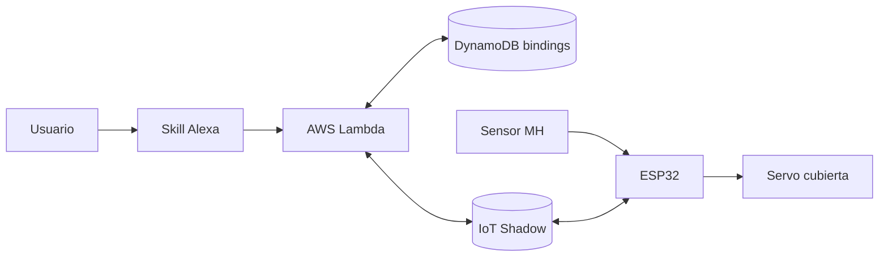
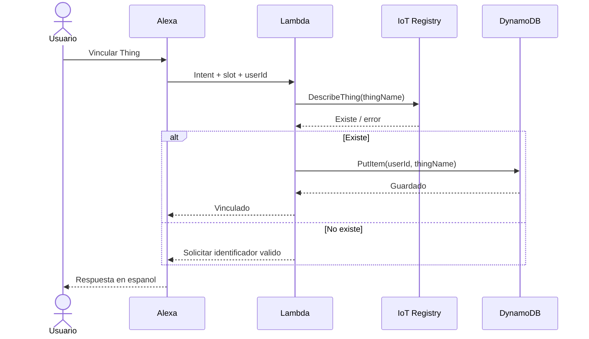
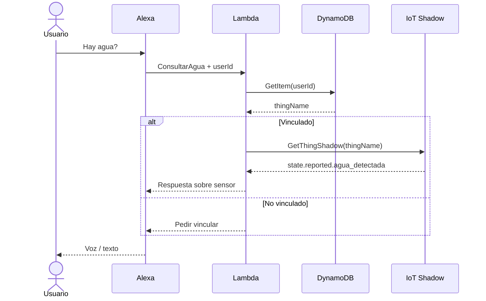
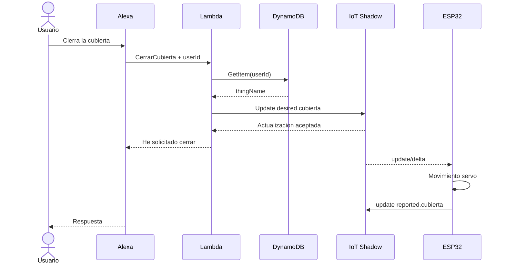
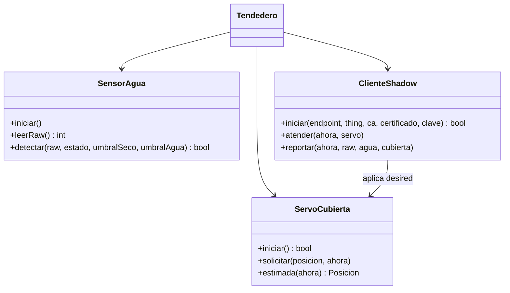
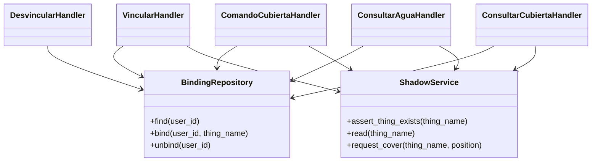
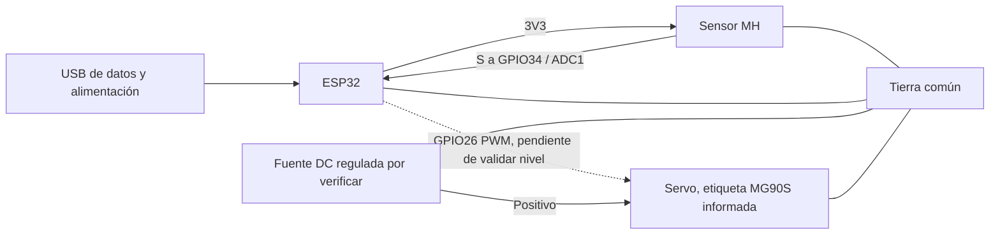

# Diagramas preliminares (revisar con implementación real)

## Arquitectura del sistema

## Secuencia: vinculación

## Secuencia: consulta del sensor

## Secuencia: comando al servo

## Clases del ESP32

`Tendedero` representa el módulo que coordina las tres clases.

## Clases de Lambda

## Circuito previsto

El diagrama identifica las conexiones previstas. Completar con foto y características de la fuente cuando se verifique la unidad física.
