# Informe técnico — Tendedero inteligente con Alexa y AWS IoT Core

**Asignatura:** SIS-234 · Ingeniería de Sistemas · Grupo 6

**Actividad:** Integración de un objeto inteligente con Alexa mediante MQTT y AWS IoT Core

**Integrantes:** Samuel Jarro Rodriguez ([Sam-J-R](https://github.com/Sam-J-R)) — hardware, firmware y ensayos RNF · María Jesús Lozada Peralta ([mjlozada](https://github.com/mjlozada)) — AWS IoT Core, Lambda y DynamoDB · Katherine Montaño Mejia ([KathM00](https://github.com/KathM00)) — Skill de Alexa, integración e informe

**Fecha:** 10 de noviembre de 2026 · **Repositorio:** [github.com/Sam-J-R/IoT_practica3](https://github.com/Sam-J-R/IoT_practica3)

## Resumen

Se implementó un prototipo distribuido para consultar presencia de agua y solicitar apertura/cierre de una cubierta de tendedero. El objeto utiliza ESP32, sensor analógico MH y servomotor; AWS IoT Core conserva su estado en un Shadow clásico, Lambda atiende la Skill y DynamoDB mantiene la asociación usuario–Thing. La Skill resuelve el dispositivo de cada usuario, sin fijar un único Thing para todas las cuentas.

Se conservan 17 capturas Alexa, cinco paneles AWS, un CSV de CloudWatch y dos videos de integración. Se observan consultas coherentes con el Shadow, actuación del brazo del servo y convergencia de una posición solicitada durante una desconexión. El montaje grabado es de banco: no demuestra una cubierta instalada bajo carga. La entrada fue textual porque el micrófono no estuvo operativo en el entorno de ensayo; no se atribuye validación del reconocimiento de voz.

Los RNF se ensayaron el 10/11 con una herramienta automatizada sobre el montaje de banco, publicando las órdenes desde el propio ESP32 en el Shadow, sin Alexa ni Lambda. Cumplieron estabilidad (15 min, 0 reinicios), clasificación (20/20 aciertos), respuesta en la modalidad ensayada (máximo 2,42 s), respaldo periódico (máximo 5,74 s en reposo) y recuperación tras reinicio y pérdida de Wi-Fi (3/3 cada uno, máximo 9,67 s). El reporte por evento no cumplió estrictamente su objetivo: 1 de 15 eventos tardó 1,033 s frente a ≤1 s. Los datos crudos, las incidencias y las sesiones fallidas se conservan (§5.5).

## 1. Caso de uso y requerimientos

### 1.1 Problema, solución y alcance

La ropa expuesta en un tendedero puede mojarse cuando cambia la condición ambiental. La solución permite consultar a distancia la clasificación de un sensor de agua y solicitar la posición de una cubierta. El usuario decide abrir/cerrar; el sensor no activa automáticamente el servo, conforme a la lógica de control del [enunciado](../referencias/Práctica_3.md).

El sensor MH responde eléctricamente a cambios de conductividad sobre su superficie. El ESP32 digitaliza y clasifica su salida; no se mide intensidad de precipitación, cantidad de agua ni porcentaje de lluvia. El servomotor representa dos posiciones mediante pulsos calibrados. No se utiliza LED como actuador, sensor ultrasónico ni conmutación de 220 V AC. El diseño requiere actuación de baja tensión DC dentro del límite de 12 V del enunciado.

El alcance demostrado es comunicación completa, lectura y actuación del servo de banco. Trasladarlo a una cubierta real requiere verificar recorrido, fuerza y alimentación bajo carga. Los indicadores luminosos integrados en los módulos no constituyen el actuador del caso de uso.

### 1.2 Requerimientos funcionales y trazabilidad

| ID | Requerimiento aplicado | Implementación | Validación disponible |
|---|---|---|---|
| RF1 | Capturar señal del sensor. | `SensorAgua`, GPIO34 y muestreo del programa principal. | INT-01 muestra `sensor_raw = 0` y `2453`; diagnóstico ADC del 7/11 en §4.2. |
| RF2 | Reportar sensor/actuador en `reported`. | `ClienteShadow::reportar`, por cambio y respaldo. | INT-01 muestra actualizaciones; intervalo medido en RNF4 (§5.5). |
| RF3 | Aplicar cambios deseados y reportar posición. | GET/delta, `ServoCubierta` y actualización posterior. | Giro del brazo y convergencia en INT-01/INT-02. |
| RF4 | Consultar sensor en español en el Thing del usuario. | `ConsultarAguaIntent` y su handler. | AX-14 e INT-01, mediante texto. |
| RF5 | Abrir/cerrar modificando `desired` del Thing vinculado. | `ComandoCubiertaHandler` y `ShadowService`. | AX-15 e INT-01; actuación de banco. |
| RF6 | Consultar estado reportado del actuador. | `ConsultarCubiertaHandler`. | AX-14 e INT-01, mediante texto. |
| RF7 | Vincular y conservar asociación entre sesiones. | Alias, `DescribeThing`, `PutItem` y `GetItem`. | AX-10/AX-11 y tabla AWS-02. |
| RF8 | Resolver por `context.System.user.userId` y guiar sin vínculo. | `_user_id`, `_bound_thing` y DynamoDB. | AX-09; prueba dinámica con dos usuarios y registro backend AWS. |
| RF9 | Validar existencia, cambiar y eliminar vínculo. | `VincularHandler` y `DesvincularHandler`. | AX-12: rechazo; AX-13: eliminación; AX-16: cambio válido. |

RF4–RF6 incluyen voz en el enunciado. Se verificó su comportamiento mediante entrada textual en Alexa; la limitación de micrófono se declara como condición del entorno, sin afirmar reconocimiento de voz probado.

### 1.3 Requerimientos no funcionales medibles

Los objetivos se declararon el 9/11, antes de los ensayos, y no se modificaron después de ver los resultados.

| ID | Atributo y objetivo de trabajo | Método | Resultado (10/11, §5.5) |
|---|---|---|---|
| RNF1 | Estabilidad: 15 min continuos, 0 reinicios y 0 bloqueos; referencia docente ≥10 min. | Log serie y operaciones durante el período, con inicio/fin. | Cumple: 15,0 min, 0 reinicios, 0 bloqueos, 15 órdenes y 14 consultas. |
| RNF2 | Clasificación: criterio propuesto ≤5 % de errores en ≥20 observaciones independientes, repartidas entre seco/agua. | Referencia física, ADC, clasificación y matriz de confusión. | Cumple: 0/20 errores (0 FP, 0 FN), condición rehecha en cada observación. Valida agua abundante, no gotas ni humedad leve. |
| RNF3 | Respuesta: referencia ≤3 s hasta posición física final. | ≥10 órdenes alternadas; tiempo desde el envío de la orden hasta la posición final. | Cumple en modalidad MQTT desde el dispositivo: máximo 2,42 s hasta la posición estimada. Sin Alexa ni Lambda. |
| RNF4 | Respaldo nominal de 5 s desde aceptación previa; criterio propuesto de ensayo ≤6 s en red estable. Objetivo por evento ≤1 s sin reporte pendiente. | Timestamps consecutivos de `update/accepted` del ESP32, intervalos y máximos. | Periódico cumple: máximo 5,74 s en reposo. Evento no cumple: 14/15 en ≤1 s, máximo 1,033 s. |
| RNF5 | Recuperar conexión y aplicar el `desired` vigente sin repetir orden. | Ensayar por separado reinicio y pérdida Wi-Fi con equipo encendido; registrar convergencia y tiempos. | Cumple: reinicio 3/3 (máximo 9,67 s) y Wi-Fi 3/3 (máximo 7,69 s), sin repetir la orden. |
| RNF6 | Modularidad: separar captura, actuación, comunicación y persistencia. | Inspección de clases, interfaces y perfiles. | Implementada en ESP32 y backend Python. |
| RNF7 | Seguridad: excluir secretos y limitar capacidades. | Plantillas, `.gitignore`, paquete y permisos AWS. | Documentada en §3.5; Lambda conserva comodín de recursos IoT justificado. |

El objetivo de evento ≤1 s no es garantía bajo desconexiones o respuestas pendientes. El criterio de ≤5 % de errores se interpreta junto con el tamaño de muestra y la referencia física usada; no se extrapola a cualquier tipo de lluvia.

## 2. Análisis y diseño

### 2.1 Arquitectura del sistema

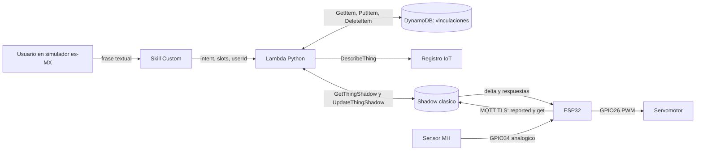

Alexa no se conecta directamente al ESP32. El dispositivo usa MQTT sobre TLS; Lambda usa APIs AWS mediante `boto3`. El Shadow desacopla disponibilidad y solicitud: conserva una posición deseada durante la desconexión. Representa estado vigente, no una cola histórica de todas las órdenes. Se usa Shadow clásico sin nombre por el contrato pequeño y la única función de cubierta.

### 2.2 Circuito y componentes

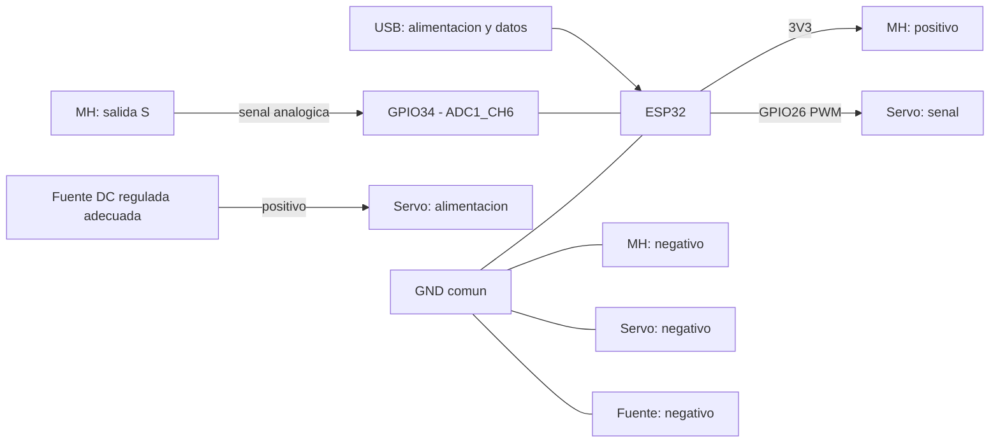

| Conexión | Función y justificación |
|---|---|
| MH `S` → GPIO34 | ADC1 evita utilizar ADC2 para esta lectura con Wi-Fi en el ESP32 clásico. |
| MH `+` → 3V3 | Alimentación prevista para señal compatible con la entrada del ESP32. |
| MH `−` → GND | Referencia de lectura. |
| Servo señal → GPIO26 | Salida PWM separada de la adquisición. |
| Servo positivo → fuente DC adecuada | La corriente del motor no se suministra por GPIO ni 3V3. |
| Negativos fuente/servo/ESP32 unidos | Referencia común para interpretar PWM. |

El diagrama corresponde al conexionado definido en el código y en [CONEXIONES.md](../hardware/CONEXIONES.md). El servo es un MG90S; el firmware usa un asentamiento de 1000 ms. Los pulsos de apertura/cierre y los umbrales del sensor se configuran localmente en `calibracion_local.h` a partir del montaje (§3.2); los umbrales usados en los ensayos fueron 200/800 cuentas (§5.5).

Se configura ADC de 12 bits y atenuación `ADC_11db`: 0–4095 son cuentas, no voltaje calibrado ni porcentaje de agua. El circuito no conmuta red eléctrica y el diseño debe respetar actuación ≤12 V DC. El procedimiento de montaje seguro está en [ENSAYO_BANCO.md](../hardware/ENSAYO_BANCO.md).

### 2.3 Clases del objeto inteligente

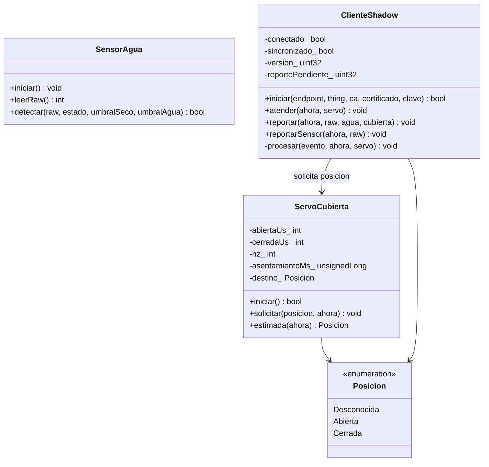

`Tendedero.cpp` es el módulo coordinador con `setup()`/`loop()`, no una clase C++ llamada Tendedero. Instancia las tres clases y ordena muestreo, red, eventos, estimación y reporte. Se puede ampliar con otra clase de sensor y nuevos atributos sin trasladar persistencia ni conversación al MCU.

### 2.4 Clases de Lambda

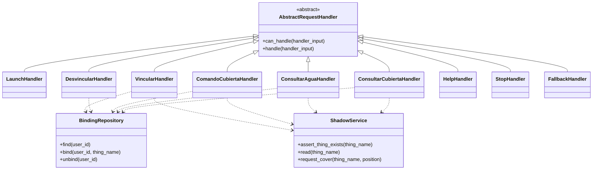

`ErrorHandler` implementa `AbstractExceptionHandler`; `SkillBuilder` registra los handlers y expone `lambda_handler`. Las funciones auxiliares resuelven usuario, slot, alias y respuesta sin duplicar esa lógica en cada intent.

### 2.5 Secuencia de vinculación

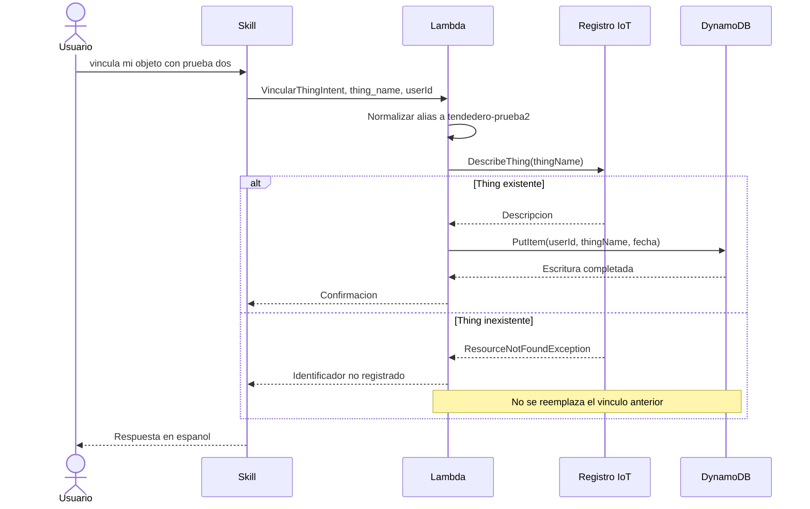

### 2.6 Secuencia de consulta del sensor

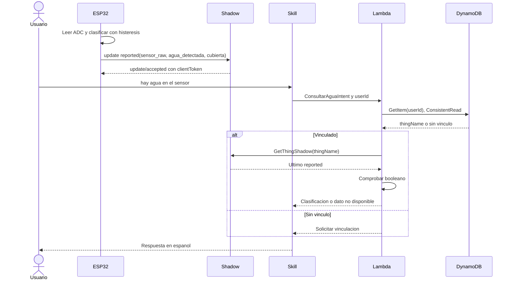

La consulta no fuerza una lectura física nueva: usa el último reporte. El backend no evalúa su antigüedad.

### 2.7 Secuencia de comando al actuador

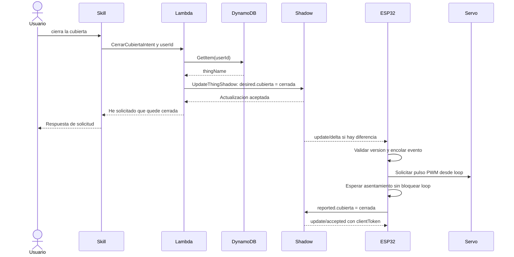

Lambda no espera el recorrido del servo. La aceptación de AWS no es confirmación mecánica: solicitud, estimación del firmware y movimiento observado son resultados distintos.

### 2.8 Recuperación del estado deseado

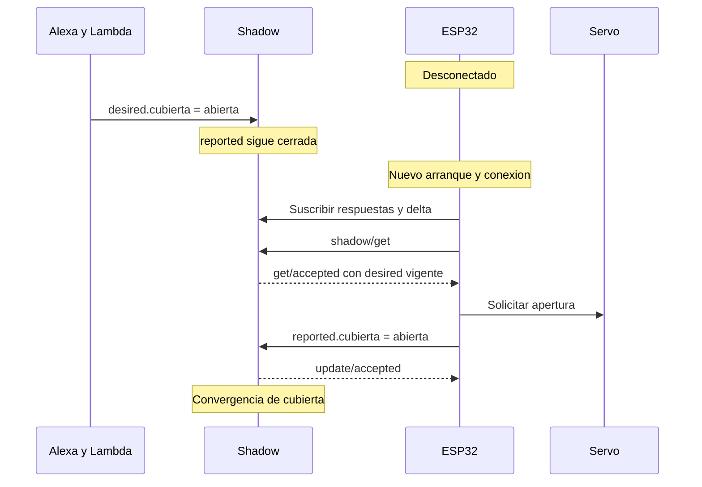

El mismo flujo aplica tras un reinicio o tras una pérdida de Wi-Fi con el equipo encendido: el video INT-02 lo muestra tras un reinicio y los ensayos RNF5 lo midieron en ambos casos (§5.5).

### 2.9 Especificación del Shadow

```json
{
  "state": {
    "desired": {"cubierta": "cerrada"},
    "reported": {
      "cubierta": "abierta",
      "agua_detectada": false,
      "sensor_raw": 0
    }
  }
}
```

| Atributo | Tipo y valores | Escritor | Uso |
|---|---|---|---|
| `state.desired.cubierta` | String: `abierta` o `cerrada`. | Lambda. | Solicitud remota. |
| `state.reported.cubierta` | String: `abierta` o `cerrada`; ausente si desconocida. | ESP32. | Posición estimada tras asentamiento. |
| `state.reported.agua_detectada` | Booleano; ausente si desconocido. | ESP32. | Clasificación consultada. |
| `state.reported.sensor_raw` | Entero 0–4095 en resolución configurada. | ESP32. | Diagnóstico; no porcentaje físico. |
| `state.delta.cubierta` | String si hay diferencia deseada. | AWS. | Notificar cambio. |
| `version` | Número de versión. | AWS. | Descartar deltas antiguos. |
| `clientToken` | String `sesion-secuencia` en reportes. | ESP32; AWS lo devuelve. | Correlacionar respuesta. |

Una actualización con `null` elimina el atributo; no equivale a seco/cerrado. Al coincidir `reported` y `desired`, desaparece la diferencia, sin borrar automáticamente el deseado. Los videos incluyen `welcome: aws-iot`, ajeno al contrato funcional; las actualizaciones parciales lo conservan.

| Tópico, con `T = nombre del Thing` | Uso del ESP32 |
|---|---|
| `$aws/things/T/shadow/get` | Publicar recuperación al conectar. |
| `$aws/things/T/shadow/get/accepted` | Recibir documento vigente. |
| `$aws/things/T/shadow/get/rejected` | Detectar ausencia o error. |
| `$aws/things/T/shadow/update` | Publicar `reported`. |
| `$aws/things/T/shadow/update/delta` | Recibir diferencias deseadas. |
| `$aws/things/T/shadow/update/accepted` | Confirmar reporte mediante token. |
| `$aws/things/T/shadow/update/rejected` | Registrar rechazo y reintentar. |

### 2.10 Mecanismo de vinculación

Tabla `tendedero_vinculaciones` en `us-east-2`: clave de partición `userId` String, sin sort key ni índices secundarios; capacidad `PAY_PER_REQUEST` en la definición entregada.

| Campo | Tipo | Función |
|---|---|---|
| `userId` | String, clave. | Identidad recibida por la Skill, no correo ni identidad biométrica. |
| `thingName` | String. | Thing validado en IoT Core. |
| `fechaVinculacion` | String ISO-8601 UTC. | Creación o reemplazo de asociación. |

`PutItem` crea/reemplaza el ítem, `GetItem` resuelve en cada consulta/control con `ConsistentRead=True` y `DeleteItem` elimina. Cerrar la conversación no ejecuta eliminación. Dos usuarios pueden tener Things distintos, pero no se impone exclusividad de un Thing por propietario.

Se valida usuario, formato, alias y existencia antes de escribir. No se demuestra posesión física: conocer un nombre válido puede permitir vincularlo. OAuth Account Linking queda fuera del alcance del enunciado; un código temporal sería una mejora.

### 2.11 Modelo de interacción

Invocación: **tendedero inteligente**. Locale: **es-MX**. Modelo: **Custom**. Slot de vincular/cambiar: **`thing_name`, `AMAZON.SearchQuery`**. Configuración: [interaction-model-es-MX.json](../alexa/interaction-model-es-MX.json).

| Intent | Frases definidas en el JSON |
|---|---|
| `VincularThingIntent` | `vincula mi objeto con {thing_name}`; `vincula el tendedero {thing_name}`; `asocia mi objeto a {thing_name}`. |
| `CambiarThingIntent` | `cambia mi objeto a {thing_name}`; `cambia el tendedero por {thing_name}`. |
| `DesvincularThingIntent` | `desvincula mi objeto`; `elimina la vinculación`; `desconecta mi tendedero`. |
| `ConsultarAguaIntent` | `hay agua en el sensor`; `está lloviendo`; `detectas lluvia`; `cómo está el sensor de agua`. |
| `AbrirCubiertaIntent` | `abre la cubierta`; `descubre el tendedero`; `abre el techo del tendedero`. |
| `CerrarCubiertaIntent` | `cierra la cubierta`; `protege el tendedero`; `cierra el techo del tendedero`. |
| `ConsultarCubiertaIntent` | `cómo está la cubierta`; `está cerrado el tendedero`; `consulta el estado de la cubierta`. |

El archivo agrega `AMAZON.CancelIntent`, `AMAZON.StopIntent`, `AMAZON.HelpIntent` y `AMAZON.FallbackIntent`. `LaunchRequest` abre sin vincular ni mover. El backend no confía solo en el slot: valida existencia.

La consola de Alexa muestra además `AMAZON.NavigateHomeIntent`, que Alexa agrega por defecto, y un slot en desvinculación que el JSON y su handler no utilizan. Ninguna de las dos diferencias afecta a los siete intents funcionales, que se probaron todos (§4.4).

## 3. Desarrollo e implementación

### 3.1 Organización y dependencias

| Ruta | Responsabilidad |
|---|---|
| [platformio.ini](../firmware/platformio.ini) | `espressif32 @ 7.0.1`, placa `esp32doit-devkit-v1`, Arduino y serie 115200. |
| [Tendedero.cpp](../firmware/src/Tendedero.cpp) | Coordinar sensor, red, eventos y reportes. |
| [SensorAgua.h](../firmware/include/SensorAgua.h) | ADC e histéresis. |
| [ServoCubierta.h](../firmware/include/ServoCubierta.h) | PWM y posición estimada. |
| [ClienteShadow.cpp](../firmware/src/ClienteShadow.cpp) y [cabecera](../firmware/include/ClienteShadow.h) | MQTT TLS, cola, GET/delta y aceptación. |
| [lambda_function.py](../lambda/lambda_function.py) | Persistencia, servicio Shadow y handlers ASK. |
| [requirements.txt](../lambda/requirements.txt) | Declara `ask-sdk-core`, `ask-sdk-model` y `boto3`. |
| [tests](../tests) | Verificaciones estáticas, importación e integración simulada. |
| [aws](../aws) | Políticas y tabla sanitizadas con `ACCOUNT_ID`. |
| [evidencias](evidencias) | Capturas, CSV y videos. |
| [ensayo_rnf.py](../ensayo_rnf.py) y [resultados](../resultados/INDICE.md) | Herramienta de ensayos RNF y sus registros. |

| Perfil | Fuente y propósito |
|---|---|
| `sensor_test` | `SensorTest.cpp`: ADC sin red ni servo. |
| `servo_test` | `ServoTest.cpp`: comandos serie `A`/`C` con calibración válida. |
| `sensor_shadow_test` | `SensorShadowTest.cpp` y cliente Shadow: reporte ADC sin actuación. |
| `tendedero_shadow` | `Tendedero.cpp` y cliente Shadow: integración final, perfil predeterminado. |
| `tendedero_ensayo` | Igual que `tendedero_shadow`, compilado con `MODO_ENSAYO_RNF`: añade comandos serie (`abrir`, `cerrar`, `estado`, `wifi_off`, `wifi_on`) y marcas de tiempo para los ensayos RNF. |

`build_src_filter` evita múltiples `setup()`/`loop()` en una compilación. Los perfiles de red usan C++17. El firmware emplea API MQTT de ESP-IDF, FreeRTOS y cJSON disponibles en la plataforma; cambiar versiones exige verificar compatibilidad PWM/MQTT.

### 3.2 Captura, clasificación y habilitación

`SensorAgua::detectar` conserva el estado anterior entre los dos umbrales. Si la lectura aumenta al mojarse, entra en agua al alcanzar un umbral y vuelve a seco al cruzar el inferior. Si disminuye, invierte signos para reutilizar la comparación. La histéresis reduce oscilaciones, pero no sustituye calibración.

`agua = -1` significa desconocido. `muestrear` calcula la clasificación suponiendo seco y suponiendo agua; si ambas coinciden puede resolver el estado inicial. En la banda ambigua conserva desconocido hasta una lectura inequívoca.

Fragmento de habilitación en [Tendedero.cpp](../firmware/src/Tendedero.cpp):

```cpp
integracion = calibracionValida() && credencialesConfiguradas() && servo.iniciar();
```

La evaluación cortocircuitada evita iniciar servo si falla una condición previa. Sin integración sigue leyendo ADC, sin iniciar Wi-Fi/MQTT. Comprueba rangos ADC, umbrales distintos, valores positivos y duración de pulso compatible con el período; no certifica por sí sola seguridad mecánica.

`__has_include` selecciona `calibracion_local.h` y `secrets.h`, o plantillas vacías si no existen. Las plantillas no contienen una calibración real ni credenciales.

### 3.3 PWM y programa principal

El servo utiliza un canal PWM de 16 bits. `solicitar` descarta posición desconocida y destino repetido, asocia el pin en la primera orden y calcula:

```text
duty = pulso_us × frecuencia_Hz × 2^16 / 1 000 000
```

Los productos intermedios usan 64 bits. Los extremos son microsegundos, no grados. `estimada` devuelve desconocida hasta transcurrir asentamiento y después el destino; no detecta atasco.

El bucle muestrea cada 500 ms mediante diferencias de `millis()`, comprueba Wi-Fi/reloj, inicia MQTT, procesa eventos, estima posición y reporta. No bloquea durante todo el recorrido del servo. Configura SNTP con `pool.ntp.org` y espera un reloj superior al mínimo de referencia antes de TLS. El intento inicial MQTT tiene control de 10 s; el cliente configura reconexión a 5 s.

### 3.4 MQTT y confirmación del Shadow

El cliente utiliza `mqtts://endpoint:8883`, client ID igual al Thing y CA/certificado/clave del dispositivo. La cola FreeRTOS de 24 eventos transfiere trabajo del callback a `atender`; la actuación ocurre desde el bucle principal.

`decodificar` compara tópicos completos, descarta mensajes incompletos y procesa JSON con cJSON; `unique_ptr` libera el documento al salir del ámbito. El búfer de entrada es 16384 bytes; no se ensamblan fragmentos mayores.

Al conectar suscribe tópicos y solicita GET. Un delta recibido durante la espera se conserva por mayor versión y se compara con el documento recuperado. Una vez sincronizado, aplica versiones mayores. GET rechazado con 404 significa Shadow ausente; otros errores fuerzan recuperación.

Se reportan cambios de clasificación/posición y respaldo de 5 s desde aceptación. Cada variación ADC no genera reporte inmediato. Hay espera de reintento de 5 s cuando existe un reporte pendiente. Las publicaciones usan QoS 0 y las suscripciones solicitan QoS 1; la aceptación de aplicación se correlaciona por `clientToken`. Encolar no equivale a aceptación del servicio.

Un rechazo conserva la necesidad de reportar. Si se llena la cola se registra y se intenta recuperar GET. Estos controles no garantizan entrega absoluta; la recuperación tras reinicio y tras pérdida de Wi-Fi se midió en RNF5 (§5.5).

### 3.5 Configuración AWS y seguridad

| Recurso | Configuración documentada |
|---|---|
| Región | `us-east-2` (Ohio). |
| Thing físico y de prueba | `tendedero-inteligente` y `tendedero-prueba2`. |
| Certificado físico | Activo, asociado al Thing y a `tendedero-inteligente-device-policy`. |
| Endpoint de datos | ATS; hostname sin protocolo ni puerto en las variables. |
| Lambda | `tendedero-inteligente-alexa`, Python 3.11, `x86_64`, handler `lambda_function.lambda_handler`. |
| Rol | `tendedero-inteligente-lambda-role`, logging y política de aplicación. |
| Memoria | El CSV registra 128 MB configurados. |
| DynamoDB | `tendedero_vinculaciones`, clave String `userId`; definición bajo demanda. |

AWS-01 acredita Things/certificado; AWS-02 tabla/vínculos y AWS-03 función/rol (§8.2). El Thing de prueba permite estados simulados sin requerir otro ESP32 físico.

| Relación | Identidad y autorización |
|---|---|
| ESP32 → IoT Core | TLS mutuo X.509 y política IoT. |
| Lambda → IoT/DynamoDB | Rol IAM; no access keys en código. |
| Alexa → Lambda | Permiso de invocación Alexa Skills Kit restringido al Skill ID, según registro AWS. |

La CA valida al servidor; certificado/clave acreditan al dispositivo. Certificado→política y certificado→Thing son asociaciones distintas. Skill ID identifica aplicación autorizada; `userId` identifica usuario para DynamoDB.

Política IoT entregada en [JSON](../aws/iot-certificate-policy.template.json):

| Acción | Recurso permitido | Motivo |
|---|---|---|
| `iot:Connect` | `client/tendedero-inteligente`. | Client ID del firmware. |
| `iot:Publish` | `topic/.../shadow/get` y `topic/.../shadow/update`. | Recuperar y reportar. |
| `iot:Subscribe` | `topicfilter/.../update/delta` y respuestas GET/UPDATE. | Autorizar suscripción. |
| `iot:Receive` | `topic/...` de esos mensajes. | Autorizar recepción. |

Los ARN usan `us-east-2` y `ACCOUNT_ID` como sustitución; se distinguen `topic`/`topicfilter`. No hay comodín global para el dispositivo.

Política IAM entregada en [JSON](../aws/lambda-iam-policy.template.json):

| Acciones | Alcance actual | Motivo |
|---|---|---|
| `iot:DescribeThing` | `Resource: "*"`. | Validar existencia antes de vincular. |
| `iot:GetThingShadow` | `Resource: "*"`. | Leer sensor/posición. |
| `iot:UpdateThingShadow` | `Resource: "*"`. | Solicitar cubierta. |
| `dynamodb:GetItem` | ARN de la tabla exacta. | Resolver usuario. |
| `dynamodb:PutItem` | ARN de la tabla exacta. | Crear/cambiar vínculo. |
| `dynamodb:DeleteItem` | ARN de la tabla exacta. | Desvincular. |

Se adjunta `AWSLambdaBasicExecutionRole` para logs. El registro de despliegue indica que el analizador de la cuenta mostró acceso IoT nulo con ARN restringidos y se adoptó el comodín para tres operaciones. Es una decisión de la práctica, no una imposibilidad técnica de restringir ARN. En producción se limitarían a los Things autorizados y se verificarían con pruebas reales. El enunciado acepta este mayor alcance si se documentan motivo y mínimo necesario.

| Variable Lambda | Valor/formato |
|---|---|
| `AWS_REGION` | La proporciona Lambda; `us-east-2`. |
| `IOT_ENDPOINT` | Host ATS sin protocolo ni puerto. |
| `DDB_BINDINGS_TABLE` | `tendedero_vinculaciones`. |
| `THING_ALIASES_JSON` | Mapa siguiente. |

```json
{
  "tendedero inteligente": "tendedero-inteligente",
  "prueba dos": "tendedero-prueba2",
  "prueba 2": "tendedero-prueba2",
  "tendedero prueba dos": "tendedero-prueba2",
  "tendedero prueba 2": "tendedero-prueba2"
}
```

Las plantillas no incluyen certificados, claves, SSID ni contraseña. `.gitignore` excluye secretos, materiales TLS y compilaciones, pero no elimina secretos previamente versionados ni protege un ZIP manual. La calibración no es credencial: sus valores medidos pueden documentarse sin revelar secretos. El [manual AWS](GUIA_AWS.md) conserva el procedimiento operativo de aprovisionamiento.

### 3.6 Backend y fragmentos clave

[lambda_function.py](../lambda/lambda_function.py) separa persistencia en `BindingRepository`, llamadas IoT en `ShadowService` y conversación en handlers. Se resuelve el Thing para cada consulta/control, sin Thing por defecto.

```python
item = self._table.get_item(
    Key={"userId": user_id}, ConsistentRead=True
).get("Item")
```

La lectura consistente recupera el vínculo de una escritura completada. `_user_id` prioriza contexto y usa sesión como alternativa; el SDK representa `userId` como `user_id`.

```python
payload = {"state": {"desired": {"cubierta": position}}}
```

`request_cover` valida abierta/cerrada y envía la actualización parcial en UTF-8. No escribe `reported` ni reemplaza todo el documento. La consulta de agua exige booleano; un atributo ausente genera dato no disponible, no seco.

La consulta de cubierta informa último reporte y orden pendiente si difiere el deseado. `_run_safe` captura errores AWS/configuración/valor y `ErrorHandler` cubre el resto. `StopHandler` termina conversación sin `DeleteItem`. Vincular y cambiar comparten handler: validan antes de `PutItem`. Desvincular utiliza `DeleteItem`. `can_handle` decide correspondencia y `handle` ejecuta; `SkillBuilder` genera la entrada Lambda.

### 3.7 Configuración Alexa e incidente de alias

Se creó Skill Custom es-MX con **Provision your own backend resources**, se cargó JSON, se construyó modelo y se configuró ARN Lambda en Endpoint. No se usa editor Code de Alexa-hosted. Las pruebas se realizaron en Development con Skill I/O.

El primer intento con «prueba dos» falló al llegar el slot como `prueba 2`. Sin alias coincidente, el fallback de normalización habría construido `prueba-2`, diferente de `tendedero-prueba2`. Se configuraron las variantes dígito/palabra y AX-10 demuestra éxito posterior. Se corrigió configuración, sin fijar un Thing para todos.

AX-01–AX-07 respaldan configuración; AX-08–AX-16 respaldan operaciones. La limitación de micrófono corresponde al entorno; no se afirma una restricción general de Alexa ni se equipara audio reproducido con reconocimiento de voz.

### 3.8 Reproducción y empaquetado

El [README](../README.md) contiene comandos de compilación/carga. Se completan localmente plantillas, se verifica montaje y se carga `tendedero_shadow`. Compilar plantillas vacías solo habilita ADC; compilar no conecta el dispositivo por sí solo.

El [ZIP](../lambda/lambda_deployment_p3.zip) incluye ASK SDK y el handler en la raíz. Su `lambda_function.py` tiene el mismo contenido que el del repositorio (solo difiere el fin de línea CRLF/LF), verificado el 10/11. `requirements.txt` declara dependencias sin versiones fijadas; no se afirma construcción totalmente reproducible del entorno. Si cambia el fuente debe reconstruirse el paquete antes de desplegar.

## 4. Pruebas y validaciones

### 4.1 Método y fuentes de evidencia

| Tipo | Qué permite concluir |
|---|---|
| Inspección de código | Implementación y parámetros, no medición física. |
| Prueba local simulada | Ejecución de handlers con AWS sustituido, no permisos reales. |
| Evento directo Lambda | Backend/persistencia/Shadow, no reconocimiento en Skill. |
| Captura del simulador | Frase y respuesta visibles. |
| Video de banco | Servo, estados y secuencia. |
| Ensayo RNF automatizado | Series temporales y conteos medidos (§5.5). |

Paneles AWS del 8/11; capturas Alexa del 8–9/11; videos del 9/11; ensayos RNF del 10/11.

### 4.2 Hardware y suite local

Los diagnósticos del 7/11 registraron 27 muestras secas `raw = 0`, 12 muestras ADC `4095` con estímulo 3V3 mediante resistencia de 220 Ω y retorno a `0` al reinstalar el sensor seco. También comprobaron reconexión Wi-Fi aislada y movimiento básico del servo. Caracteriza entrada/actuación, no exactitud frente a agua real.

| Archivo de prueba | Cantidad | Alcance |
|---|---:|---|
| [test_static_contract.py](../tests/test_static_contract.py) | 9 | Sintaxis, JSON, intents, operaciones AWS, ADC, perfiles y controles presentes en fuente. |
| [test_lambda_import.py](../tests/test_lambda_import.py) | 1 | Importación con SDK del ZIP y stub AWS. |
| [test_lambda_integration.py](../tests/test_lambda_integration.py) | 2 | Dos usuarios/Things, enrutamiento, cambio, rechazo, eliminación y clasificación desconocida. |

La suite se ejecutó el 7/11 (Python 3.11) y de nuevo el 10/11 sobre la revisión final (Python 3.13): **12/12 satisfactorias** en ambas. Los cuatro perfiles compilaron el 7/11, y `tendedero_ensayo` se compiló y cargó el 10/11 para los ensayos RNF.

### 4.3 Pruebas directas AWS

| ID | Escenario | Resultado registrado | Respaldo |
|---|---|---|---|
| AWS-BE-01 | LaunchRequest directo. | Carga de handler y bienvenida. | Registro backend/AWS-04. |
| AWS-BE-02 | Vincular Thing existente. | Validación y persistencia con fecha. | AWS-02 y registro backend. |
| AWS-BE-03 | Consultar agua simulada. | Respuesta acorde al booleano. | Registro backend; INT-01 complementa integración. |
| AWS-BE-04 | Solicitar cierre. | Escritura de `desired`. | Registro backend; AX-15. |
| AWS-BE-05 | Consultar cubierta. | Ejecución satisfactoria y respuesta abierta coherente. | AWS-05. |
| AWS-BE-06 | Simular convergencia. | `reported` igual a `desired`. | Shadow simulado AWS-05. |
| AWS-BE-07 | Thing inexistente. | Rechazo sin reemplazar vínculo. | Registro backend y código; AX-12 muestra rechazo. |
| AWS-BE-08 | Dos usuarios/Things. | Resolución por asociación propia. | Dos ítems AWS-02 y pruebas directas registradas; no dos cuentas Alexa grabadas. |
| AWS-BE-09 | Cambiar vínculo. | Nuevo Thing para misma clave. | Registro backend; AX-16 añade prueba Skill. |
| AWS-BE-10 | Desvincular. | Eliminación y guía posterior. | Registro backend; AX-09/AX-13. |
| AWS-BE-11 | Logs. | START/END/REPORT sin excepciones visibles en fragmento. | AWS-04 y CSV. |

Estas pruebas corresponden a la revisión `a8a86c3`. Los cinco paneles y el CSV están en [evidencias/aws](evidencias/aws/README.md) y el registro detallado en [EVIDENCIAS_AWS.md](EVIDENCIAS_AWS.md).

### 4.4 Frases probadas en la Skill

| ID | Entrada | Resultado observado | Evidencia |
|---|---|---|---|
| AX-08 | `abre tendedero inteligente` | Saludo. | [Inicio](evidencias/alexa/08-alexa-inicio.png). |
| AX-09 | Desvincular y `hay agua en el sensor` | Confirma borrado y solicita vínculo. | [Sin vínculo](evidencias/alexa/09-alexa-sin-vinculo.png). |
| AX-10 | `vincula mi objeto con prueba dos` | Confirma `tendedero-prueba2`. | [Vinculación](evidencias/alexa/10-alexa-vinculacion.png). |
| AX-11 | `para`, abrir y consultar | Conserva asociación entre conversaciones. | [Persistencia](evidencias/alexa/11-alexa-persistencia.png). |
| AX-12 | `cambia mi objeto a objeto inexistente nueve` | Rechaza identificador. | [Caso negativo](evidencias/alexa/12-alexa-thing-inexistente.png). |
| AX-13 | `desvincula mi objeto` | Confirma eliminación. | [Desvinculación](evidencias/alexa/13-alexa-desvinculacion.png). |
| AX-14 | Consultar agua y cubierta | Agua negativa/afirmativa y cubierta cerrada. | [Consultas](evidencias/alexa/14-alexa-sensor-seco-y-con-agua.png). |
| AX-15 | `abre la cubierta`; `cierra la cubierta` | Confirma solicitud de cada posición. | [Control](evidencias/alexa/15-alexa-abrir-y-cerrar-cubierta.png). |
| AX-16 | Vincular prueba dos y `cambia mi objeto a tendedero inteligente` | Cambio al Thing físico. | [Cambio válido](evidencias/alexa/16-alexa-cambio-valido.png). |

Se ejecutaron todos los intents; la tabla lista los que tienen captura. Ayuda y fallback se probaron sin captura.

### 4.5 Videos de integración y recuperación

| Video | Marca aproximada | Observación |
|---|---|---|
| [INT-01 — 21,70 s](evidencias/integracion/01-funcionamiento-completo.mp4) | 00:00 | Shadow abierto, sensor `0`/`false`. |
| INT-01 | 00:02–00:08 | Apertura/consulta, servo visible y giro durante secuencia de cierre. |
| INT-01 | 00:09–00:10 | Deseado/reportado cerrados; sensor `0`/`false`. |
| INT-01 | 00:13–00:16 | Respuesta negativa; después Shadow `2453`/`true`. |
| INT-01 | 00:19–00:21 | Respuesta afirmativa del sensor. |
| [INT-02 — 26,16 s](evidencias/integracion/02-recuperacion-orden-reconexion.mp4) | 00:05–00:09 | Solicitud abierta; reportado cerrado y delta abierto. |
| INT-02 | 00:11–00:24 | Montaje durante retorno a operación; giro del brazo al final. |
| INT-02 | 00:25–00:26 | Deseado/reportado abiertos, sin diferencia anterior en vista mostrada. |

En INT-02 se desconectó el cable, se solicitó la apertura y se reconectó sin repetir la orden. El video muestra los estados previo y final y la actuación. Las marcas localizan escenas; los tiempos se midieron aparte (§5.5).

Los videos no muestran una cubierta bajo carga. El [índice audiovisual](evidencias/integracion/README.md) conserva el detalle.

### 4.6 Protocolo RNF

Protocolo de referencia, definido antes de los ensayos. Su ejecución del 10/11, las adaptaciones al entorno sin consola AWS y los resultados están en §5.5 y en [RESULTADOS_RNF.md](RESULTADOS_RNF.md).

| Ensayo | Procedimiento | Datos y cálculo | Criterio |
|---|---|---|---|
| Estabilidad | Operar 15 min sin interrupción intencional, con consultas/órdenes. | Inicio/fin, operaciones, reinicios, bloqueos y log continuo. | 15 min, 0 reinicios, 0 bloqueos. |
| Exactitud | Calibrar y validar en lote distinto de ≥20 referencias físicas seguras, con ambos estados/transiciones. | Referencia, ADC, booleano, falsos positivos/negativos; errores/n × 100. | Propuesto ≤5 % de error, informando n y tipos. |
| Respuesta | ≥10 órdenes alternadas con envío y brazo visibles. | Final − envío; promedio, mediana, máximo y excedencias. | Referencia ≤3 s, declarando inicio textual. |
| Reporte | ≥10 mensajes aceptados del ESP32 y cambios de clasificación/posición. | Timestamps, intervalos, máximos; identificar token para no mezclar actualizaciones Lambda. | Propuesto ≤6 s estable y objetivo de evento ≤1 s sin reporte pendiente. |
| Reconexión | Separar reinicio y pérdida Wi-Fi; ordenar posición opuesta durante ausencia. | Estado previo, deseado, retorno MQTT, giro, aceptación, tiempos y repeticiones. | Converger sin repetir la orden, en ≤30 s. |

Un desconocido del sensor debe contarse, no convertirse en seco ni excluirse sin explicación. La medición manual declara incertidumbre. Los fallos se conservan junto con corrección y repetición.

### 4.7 Errores y discusión

| Situación | Diagnóstico | Tratamiento/interpretación |
|---|---|---|
| «prueba dos» no vinculaba. | Slot normalizado a `prueba 2`. | Añadir variantes; AX-10 verifica éxito. |
| Micrófono no operativo. | Condición del entorno. | Entrada textual identificada; sin afirmar reconocimiento de voz probado. |
| Respuesta sin nueva vinculación. | Persistencia DynamoDB. | AX-11 demuestra comportamiento esperado. |
| Solicitud aceptada sin dispositivo. | `desired` puede cambiar sin movimiento inmediato. | INT-02 muestra orden pendiente y convergencia posterior. |
| Posición reportada sin realimentación. | Estimación temporal. | Se distingue de confirmación mecánica. |
| Dato histórico consultado. | No se revisa antigüedad. | Una respuesta sola no demuestra conexión activa. |
| Monitor MQTT del PC rechazado (10/11). | La política solo admite el clientId del dispositivo. | Observación desde el ESP32 (`update/accepted`) y uso del certificado en el PC solo con el ESP32 fuera de línea. |
| Ensayo Wi-Fi interrumpido dos veces. | Firmware cargado sin el comando `wifi_off`. | Se cargó el firmware de ensayo actualizado; ensayo completo a las 10:19. |
| Reinicio sin conexión MQTT en 270 s. | Probable ausencia del punto de acceso: minutos después el ESP32 informó `sin wifi estado=1`. | Ensayo repetido con la red disponible: 3/3. La recuperación depende de la disponibilidad del punto de acceso. |
| Log cortado. | Disco del PC lleno. | Ensayo invalidado y repetido; la herramienta verifica ahora el espacio libre. |
| Intervalos periódicos de hasta 6,97 s. | Siguen a consultas de ensayo del Shadow desde el ESP32, inexistentes en la operación real. | Se midió además en reposo según la guía: máximo 5,74 s. Se informan ambos. |

## 5. Resultados

### 5.1 Resultados registrados

Hay **17 capturas Alexa, 5 paneles AWS, 1 CSV, 2 videos y los registros de 6 ensayos RNF**. La evidencia respalda el flujo Skill → Lambda → DynamoDB/Shadow, la persistencia, el rechazo, el cambio y el borrado del vínculo; los videos añaden la actuación del servo de banco y la recuperación de una posición deseada tras reinicio.

| Dato | Valor | Interpretación |
|---|---|---|
| Resolución configurada | 12 bits, 0–4095. | Parámetro de adquisición, no exactitud. |
| Estados INT-01 | `0`/`false` y `2453`/`true`. | Dos reportes y consultas coherentes. |
| Muestreo/respaldo configurados | 500 ms / 5000 ms. | Parámetros del firmware. |
| Duraciones INT-01/INT-02 | 21,70 s / 26,16 s. | Duración de archivo, no estabilidad o latencia. |
| Intervalo de reporte medido | Promedio 5,39 s, máximo 5,74 s en reposo. | Frecuencia efectiva del 10/11, §5.5. |
| Suite local | 12/12. | 7/11 y 10/11. |
| Fuente/ZIP | Mismo contenido. | Verificación del handler empaquetado. |

### 5.2 Cálculo sobre CloudWatch

El [CSV original](evidencias/aws/04-cloudwatch-eventos.csv) contiene cuatro REPORT. Se extrajo `Duration`, sin confundirlo con `Billed Duration` ni tiempo de movimiento:

| Ejecución | Duration (ms) | Observación |
|---:|---:|---|
| 1 | 4045,84 | Registra aparte `Init Duration = 689,80 ms`. |
| 2 | 457,30 | Ejecución Lambda. |
| 3 | 622,83 | Ejecución Lambda. |
| 4 | 673,31 | Ejecución Lambda. |
| **Promedio** | **1449,82** | Incluye las cuatro, sin excluir la primera. |

Mínimo **457,30 ms**, máximo **4045,84 ms**. No se identifica el intent de cada ejecución; no se presentan como cuatro órdenes de servo. No permiten concluir ≤3 s extremo a extremo, pues no incluyen todos los tramos hasta movimiento físico. 
### 5.3 Justificación de frecuencia y consumo

La variable funcional es presencia de agua/posición, no cada fluctuación ADC. Histéresis y reporte por cambio reducen ruido y el respaldo refresca el estado aun sin cambio de categoría.

En régimen ideal, 5 s por reporte equivalen a `60/5 = 12` reportes/min y `86400/5 = 17280` reportes/día por dispositivo continuamente conectado, antes de eventos, reintentos, GET y respuestas. La capa gratuita de AWS IoT Core cubre un volumen de mensajes limitado al mes, por lo que este ritmo es adecuado para la demostración, pero en operación continua conviene ampliar el respaldo periódico.

El intervalo medido en reposo, 5,39 s de promedio, equivale a unos 11 reportes/min o 16 000/día, antes de eventos y respuestas. La lluvia cambia en escala de segundos a minutos, de modo que un respaldo de 30–60 s, combinado con el reporte inmediato por evento (promedio 0,56 s), mantendría la reacción ante el inicio de lluvia y reduciría el consumo entre 6 y 12 veces.

### 5.4 Balance de verificación

| Aspecto | Conclusión sustentada |
|---|---|
| Configuración/backend | Desplegados, respaldados por paneles, JSON, respuestas y registro AWS. |
| Skill | Operaciones verificadas por texto, incluida persistencia/cambio. |
| Actuación | Brazo del servo de banco visible; sin prueba de cubierta bajo carga. |
| Recuperación | Medida tras reinicio por EN y tras pérdida de Wi-Fi con el equipo encendido: 3/3 en cada caso (§5.5). |
| Exactitud, estabilidad y tiempos | Medidos el 10/11 (§5.5), con órdenes MQTT desde el dispositivo y posición estimada; no incluyen Alexa ni la posición física. |
| Voz | Entrada textual en el simulador por limitación de micrófono del entorno. |

### 5.5 Resultados RNF

Ensayos del 10/11/2026, 09:48–11:15, con [`ensayo_rnf.py`](../ensayo_rnf.py) y el firmware `tendedero_ensayo`. Condiciones, discusión e incidencias completas: [RESULTADOS_RNF.md](RESULTADOS_RNF.md). Datos crudos y sesiones fallidas: [`resultados/`](../resultados/INDICE.md).

| ID | Objetivo (§1.3) | Resultado medido | ¿Cumple? |
|---|---|---|---|
| RNF1 | 15 min, 0 reinicios, 0 bloqueos | 15,0 min; 15/15 órdenes, 14/14 consultas; 0 reinicios, 0 bloqueos, 0 desconexiones MQTT | Cumple |
| RNF2 | ≤5 % de errores, ≥20 observaciones independientes | 20 observaciones (10/10): 0 errores; ADC seco 0, con agua 1745–2221 | Cumple |
| RNF3 | ≤3 s hasta la posición final | 10/10; promedio 2,19 s, máximo 2,42 s hasta la posición estimada; envío → delta 1,19 s de promedio | Cumple en modalidad MQTT desde el dispositivo |
| RNF4 | Periódico ≤6 s; evento ≤1 s sin reporte pendiente | Reposo: 54 intervalos, promedio 5,39 s, máximo 5,74 s. Evento: 14/15 en ≤1 s, máximo 1,033 s | Periódico: cumple. Evento: no cumple |
| RNF5 | `desired` aplicado sin repetir la orden; ≤30 s | Reinicio por EN: 3/3, máximo 9,67 s. Wi-Fi: 3/3, máximo 7,69 s | Cumple |

Adaptaciones al entorno sin consola AWS: las órdenes las publica el ESP32 con el mismo documento que Lambda; la pérdida de red es una desasociación provocada por el ESP32; el reinicio usa la línea RTS sobre el pin EN y no corta la alimentación del servo; y la posición es la estimada al terminar el asentamiento de 1 s. En RNF2 la referencia fue una toalla mojada en contacto con el sensor (agua) y su parte seca para secarlo (seco), rehaciendo la condición en cada observación; los umbrales 200/800 son estimaciones del equipo, sin lote de calibración registrado, y el ensayo no evalúa gotas aisladas ni humedad leve. Durante la estabilidad, 10 de 158 intervalos periódicos superaron 6 s (máximo 6,97 s). Todos siguen a consultas de ensayo del Shadow desde el ESP32, que no existen en la operación real; por eso la frecuencia se midió también en reposo, como indica la guía.

## 6. Conclusiones

1. La arquitectura mantiene interacción mediante Shadow y separa interfaz, backend y objeto. El estado deseado persistente permitió observar recuperación tras nuevo arranque.
2. DynamoDB separa vínculo y sesión. Persistencia y cambio válido muestran una Skill no fijada a un Thing; el aislamiento multiusuario cuenta con pruebas directas y simuladas, diferenciadas de dos cuentas Alexa grabadas.
3. Los alias resolvieron un error real de normalización. Validar existencia antes de escribir evita reemplazar el vínculo por un identificador no registrado.
4. Capturas y videos respaldan consultas/actuación de banco, no posición bajo carga, porcentaje de lluvia ni error de medición. La posición del firmware es estimada.
5. Los ensayos del 10/11 sostienen estabilidad durante 15 min, clasificación sin errores en 20 observaciones, respuesta de 2,42 s como máximo en el trayecto dispositivo–AWS–servo, respaldo periódico de 5,74 s como máximo en reposo y recuperación de la orden pendiente en menos de 10 s. No sostienen el objetivo de evento ≤1 s, superado por 0,033 s en 1 de 15 casos, ni la latencia con Alexa: la primera invocación de Lambda tras inactividad duró por sí sola 4,05 s.
6. Las clases y el contrato permiten extensión con nuevos sensores/actuadores, acompañada de permisos y pruebas. La modalidad verificada fue textual, sin afirmar reconocimiento de voz validado.

## 7. Recomendaciones

1. Calibrar los umbrales del sensor con un lote registrado que incluya gotas y humedad leve, y validar después con un lote distinto. Repetir RNF3 con órdenes desde Alexa y video continuo para medir el recorrido completo, incluida la primera invocación tras inactividad. Documentar parámetros físicos finales no secretos.
2. Verificar fuerza, recorrido, topes y corriente con cubierta real. Añadir finales de carrera o medición de posición para detectar atasco.
3. Evaluar antigüedad y conexión al responder consultas; evitar interpretar dato histórico como lectura actual.
4. Incorporar prueba de posesión para vincular y restringir recursos IoT del rol, con verificación real de permisos.
5. Ensayar la pérdida de red apagando el punto de acceso y el reinicio con corte real de alimentación, además de errores de suscripción, fragmentación y falta de aceptación. Registrar en el firmware final el estado del Wi-Fi para diagnosticar ausencias de red como la del 10/11.
6. Para uso continuo estudiar corrosión, alimentación por lectura, filtrado y protección ambiental sin cambiar la lógica de control requerida.
7. Fijar dependencias y construcción del ZIP; sincronizar exportación de consola y repositorio, incluidas diferencias de intents integrados/slots.
8. Revisar uso de mensajes y alerta de costos antes de operación continua. No existe evidencia que permita certificar alerta de facturación configurada.

## 8. Anexos

### 8.1 Entregables y archivos

El informe integra el contenido técnico sin sustituir los registros de trabajo de cada área: se conservan la [documentación de Alexa](ALEXA.md), la [documentación original AWS](EVIDENCIAS_AWS.md), su [guía de configuración](GUIA_AWS.md), el [esquema DynamoDB](../aws/dynamodb-schema.md) y la [matriz de pruebas](PRUEBAS.md). Las imágenes y el CSV AWS reutilizados mantienen su contenido original.

| Entregable | Ubicación |
|---|---|
| Informe técnico | Este archivo. |
| Código objeto | [firmware/src](../firmware/src) y [firmware/include](../firmware/include). |
| Código backend | [lambda_function.py](../lambda/lambda_function.py). |
| Modelo Alexa JSON | [interaction-model-es-MX.json](../alexa/interaction-model-es-MX.json). |
| Política IoT | [iot-certificate-policy.template.json](../aws/iot-certificate-policy.template.json). |
| Política IAM | [lambda-iam-policy.template.json](../aws/lambda-iam-policy.template.json). |
| Definición tabla | [dynamodb-table.template.json](../aws/dynamodb-table.template.json). |
| Configuración sin secretos | [secrets.example.h](../firmware/include/secrets.example.h), [calibracion.example.h](../firmware/include/calibracion.example.h), [config.h](../firmware/include/config.h). |
| Diagramas completos | §2.1–2.8. |
| Pruebas, frases y resultados | §4–§5. |
| Ensayos RNF | [RESULTADOS_RNF.md](RESULTADOS_RNF.md), [resultados/](../resultados/INDICE.md), [ensayo_rnf.py](../ensayo_rnf.py) y [procedimiento](ENSAYOS_RNF_SIN_CONSOLA.md). |

### 8.2 Figuras AWS

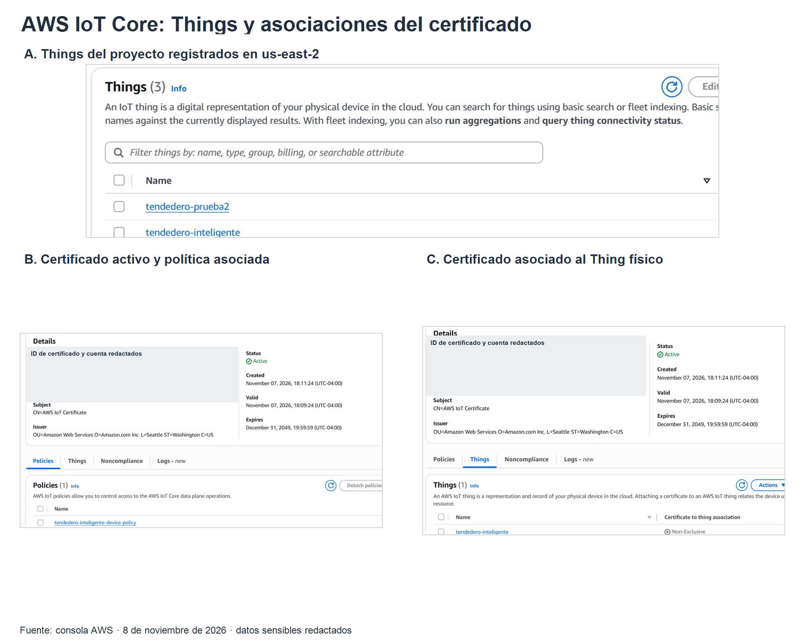

**AWS-01.** Consola, 8/11/2026: Things, certificado activo y asociaciones. Identificadores ocultados en el original sanitizado.

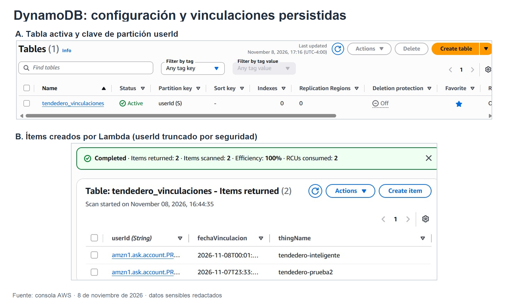

**AWS-02.** Tabla activa, clave String y dos ítems con Things distintos; usuarios truncados. No representa dos sesiones de voz grabadas.

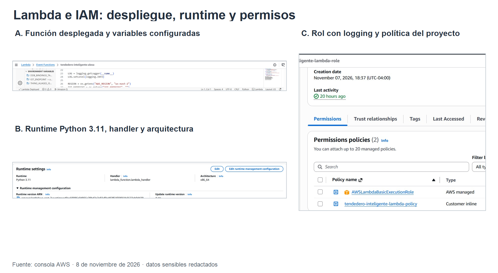

**AWS-03.** Función, variables, runtime, handler, arquitectura y políticas del rol; alcance detallado en §3.5.

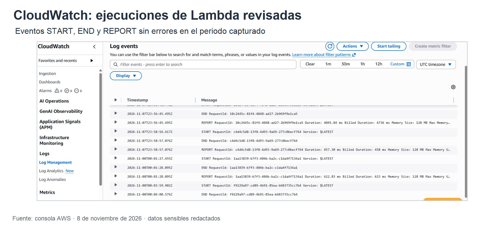

**AWS-04.** Ejecuciones del 7–8/11 UTC, consolidadas el 8/11. El [CSV](evidencias/aws/04-cloudwatch-eventos.csv) reproduce §5.2.

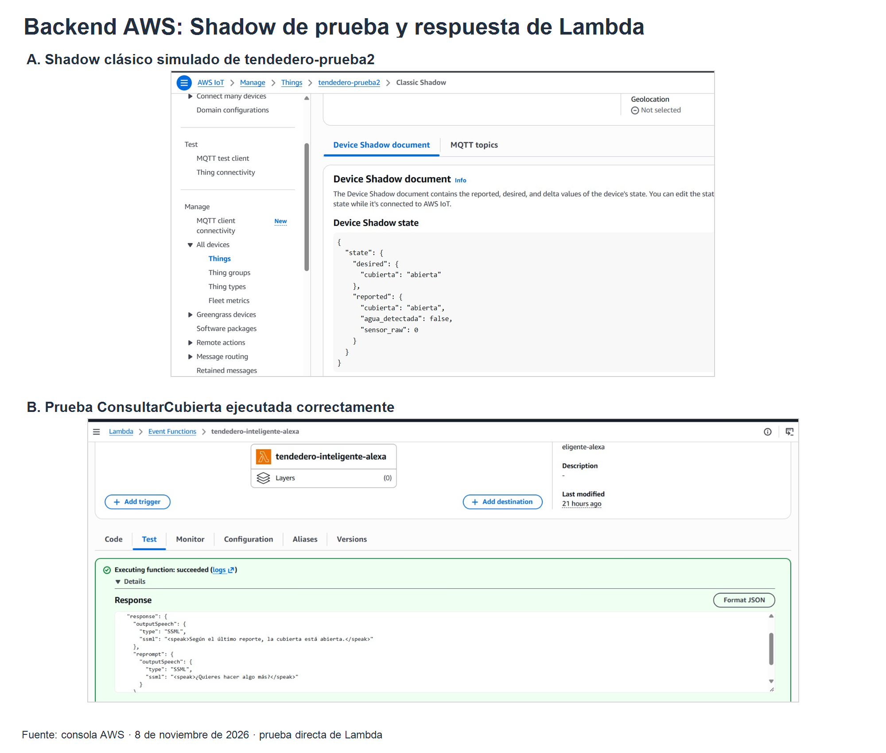

**AWS-05.** Shadow simulado de `tendedero-prueba2` y respuesta directa abierta. No se presenta como prueba física.

### 8.3 Figuras Alexa

El [índice de 17 capturas](evidencias/alexa/README.md) identifica todos los archivos. Se destacan:

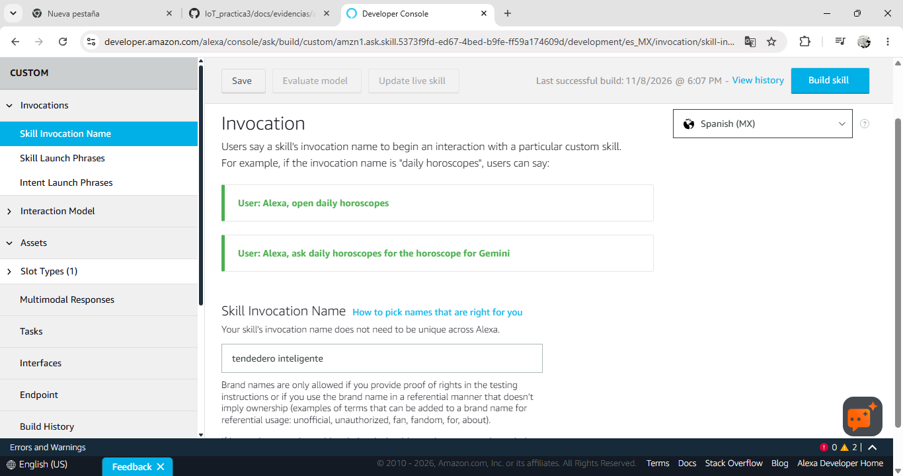

**AX-01.** Nombre de invocación e idioma.

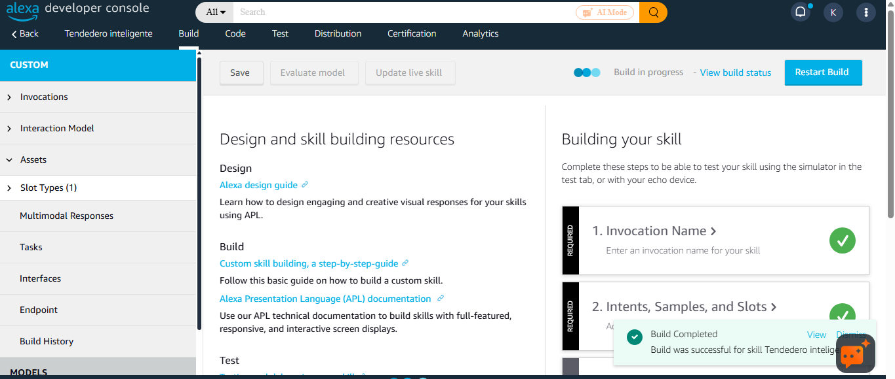

**AX-05.** Notificación Build Completed; se conservan los elementos de estado originales de consola.

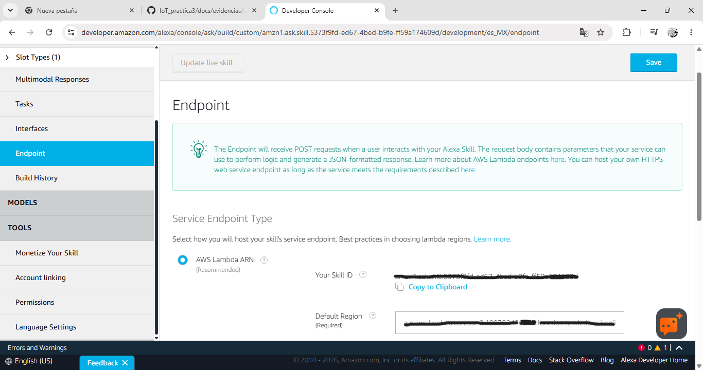

**AX-06.** AWS Lambda ARN con campos parcialmente ocultos; respuestas de ejecución corroboran conexión.

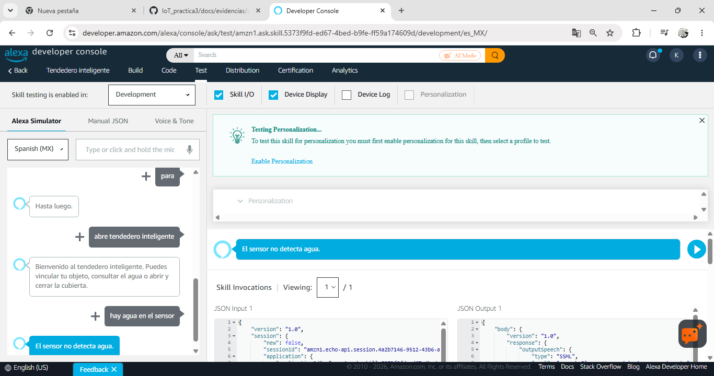

**AX-11.** Detener, abrir y consultar sin nueva asociación.

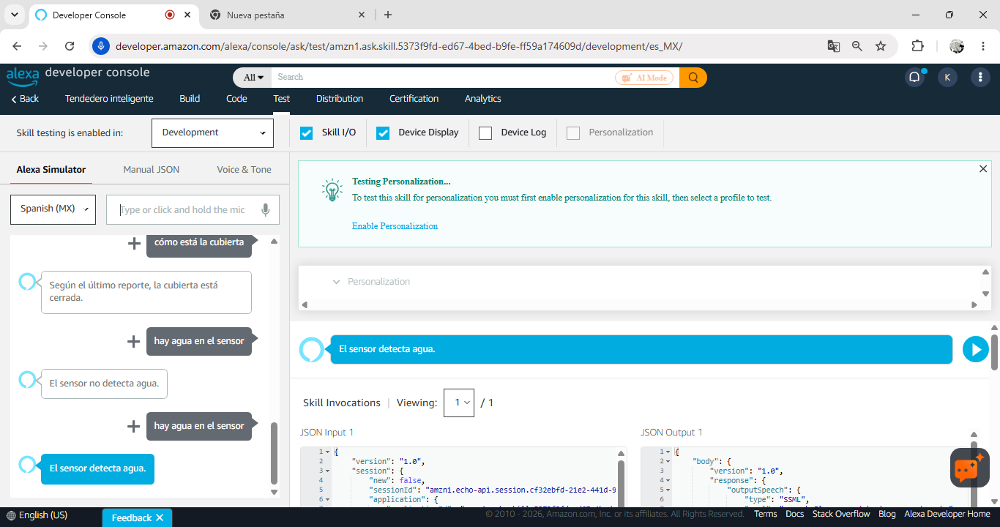

**AX-14.** Estados del sensor y consulta de cubierta.

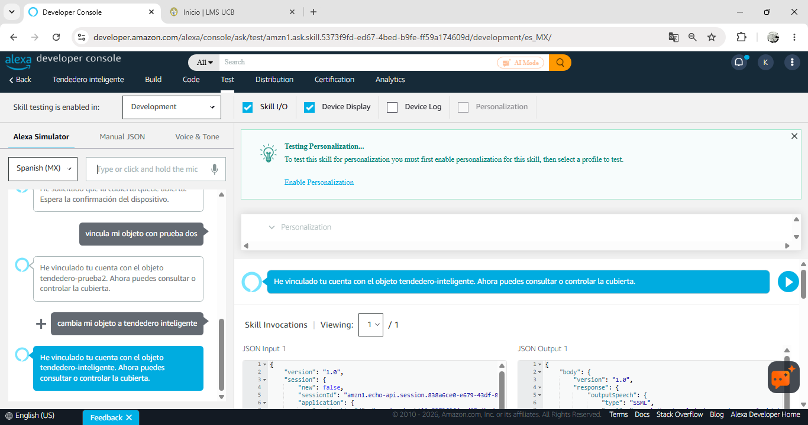

**AX-16.** Paso del Thing de prueba al físico; complementa rechazo y eliminación de AX-12/AX-13.

### 8.4 Videos y fotografías

- [INT-01 — funcionamiento completo](evidencias/integracion/01-funcionamiento-completo.mp4).
- [INT-02 — recuperación de orden](evidencias/integracion/02-recuperacion-orden-reconexion.mp4).
- [Índice audiovisual con marcas](evidencias/integracion/README.md).
- [ESP32](../referencias/esp32.jpeg), [sensor frontal](../referencias/sensor_frente.jpeg) y [reverso](../referencias/sensor_reverso.jpeg).

### 8.5 Aportes y entrega

Cada integrante hizo commits con su propia cuenta de GitHub; el historial completo se consulta con `git log --all --oneline`.

| Integrante | Área | Commits principales |
|---|---|---|
| Samuel (Sam-J-R) | Firmware, hardware y ensayos RNF | `0a57f38`, `45e5238`, `8778586` |
| María Lozada (mjlozada) | AWS IoT Core, Lambda, DynamoDB e IAM | `341e17a`, `3e5bb31`, `a8a86c3` |
| Kathy (KathM00) | Skill de Alexa, integración, videos e informe | `9fca64a`, `8c28234`, `542cc8c`, `978b012` y la integración final |

El enlace al repositorio se entrega por LMS-UCB.

### 8.6 Correspondencia con el enunciado

| Exigencia | Sección |
|---|---|
| Caso de uso, justificación y restricciones | 1.1 y 2.2. |
| RF/RNF medibles y trazables | 1.2–1.3, 4.6, 5.4 y 5.5. |
| Arquitectura y circuito | 2.1–2.2. |
| Clases del objeto y Lambda | 2.3–2.4. |
| Secuencias de vincular, consultar y actuar | 2.5–2.7; recuperación 2.8. |
| Shadow, vinculación y modelo de Skill | 2.9–2.11. |
| Código modular, fragmentos y enlaces | 3.1–3.4 y 3.6. |
| AWS/Alexa y permisos justificados | 3.5 y 3.7–3.8. |
| Pruebas, frases, validaciones y errores | 4. |
| Resultados cuantificables y límites | 5. |
| Conclusiones y recomendaciones | 6–7. |
| Configuraciones, diagramas, evidencias y entrega | 8. |

### 8.7 Fuentes

Implementación y evidencias del repositorio son las fuentes primarias. Referencias de plataforma asociadas a los apartados indicados:

- [Enunciado de la práctica](../referencias/Práctica_3.md).
- [AWS: documento Shadow](https://docs.aws.amazon.com/iot/latest/developerguide/device-shadow-document.html), para estados, delta, versión y `null` (§2.9).
- [AWS: autorización IoT](https://docs.aws.amazon.com/iot/latest/developerguide/iot-authorization.html), para identidad y políticas (§3.5).
- [AWS: GetItem](https://docs.aws.amazon.com/amazondynamodb/latest/APIReference/API_GetItem.html), para lectura por clave/consistencia (§2.10 y §3.6).
- [Amazon: solicitudes de Skill](https://developer.amazon.com/en-US/docs/alexa/custom-skills/handle-requests-sent-by-alexa.html), para handlers e identidad (§3.6–3.7).
- [Espressif: ADC ESP32](https://docs.espressif.com/projects/esp-idf/en/v4.2.4/esp32/api-reference/peripherals/adc.html), para GPIO34/ADC1 (§2.2).
