# Informe técnico — Práctica 4: Tendedero inteligente con procesamiento, almacenamiento y lógica Edge / Nube

**Asignatura:** SIS-234 · Ingeniería de Sistemas · Grupo 6

**Integrantes:** Samuel Jarro Rodriguez ([Sam-J-R](https://github.com/Sam-J-R)) — hardware, firmware y ensayos del ESP32 · María Jesús Lozada Peralta ([mjlozada](https://github.com/mjlozada)) — AWS IoT Core, reglas, Lambdas de la Nube y DynamoDB · Katherine Montaño Mejia ([KathM00](https://github.com/KathM00)) — Skill de Alexa, evidencias de la Skill e informe

**Fecha:** 24 de noviembre de 2026 · **Repositorio:** [github.com/Sam-J-R/IoT_practica3](https://github.com/Sam-J-R/IoT_practica3) (rama `practica_4`) · Informe de la práctica 3: [INFORME.md](INFORME.md)

## Resumen

El tendedero de la práctica 3 (ESP32, sensor de agua y servo controlados por Alexa a través del Device Shadow) se amplió a un sistema distribuido. El ESP32 incorpora un LDR y un LED, y ejecuta la lógica urgente (R1: resguardar con lluvia; R5: resguardar de noche) aunque no tenga Internet. En la Nube, tres reglas de AWS IoT y tres Lambdas guardan el histórico en DynamoDB y ejecutan la lógica que necesita datos históricos o que el objeto no puede detectar por sí mismo (R2: volver a exponer; R3: equipo sin reportar; R4: exceso de movimientos). La Skill permite consultar y cambiar por voz el modo y la espera de la lógica automática, calibrar el sensor y manejar varios tendederos por usuario.

Resultados principales: integridad del almacenamiento del **100 %** con latencia máxima de **2,0 s**; R1 resguarda en **1,1 s** desde que detecta agua; R2 actúa **51 s** después de cumplirse su condición; reconexión en **6–7 s**; costo estimado de **USD 0,21–1,37 al mes** por tendedero.

---

## 1. Caso de uso y requerimientos

### 1.1 Caso de uso y ampliación respecto a la práctica 3

**Problema.** Quien tiende ropa al aire libre la pierde de vista: un chubasco la moja de nuevo, y si queda afuera de noche el sereno la vuelve a humedecer. En la práctica 3 el usuario podía resguardarla por voz, pero solo si se enteraba a tiempo.

**Solución ampliada.** Un brazo con servomotor gira el tendedero hasta dejarlo bajo un techo fijo. Ahora el tendedero se protege solo (lluvia y noche), vuelve a sacar la ropa cuando pasó la lluvia y hay luz, avisa si el equipo deja de reportar y guarda un histórico con el que el usuario decide cuándo y dónde tender. Los cambios respecto a la práctica 3 y su motivo están en [CAMBIOS.md](practica4/CAMBIOS.md).

### 1.2 Sensores y actuadores elegidos

| Componente | Tipo | Pin | Justificación |
|---|---|---|---|
| Sensor de lluvia (módulo MH, salida analógica) | Sensor | GPIO34 (ADC1) | Detecta el inicio y el fin de la lluvia sobre la superficie expuesta; es la variable que decide R1 y R2. Se calibra desde Alexa (seco / mojado). |
| LDR | Sensor | GPIO35 (ADC1) | Detecta la noche (R5) y si hay luz para volver a exponer (R2). Mide la luz real en lugar de usar la hora, que cambia con la estación y no sabe si el día está oscuro. |
| Servomotor | Actuador principal (no LED) | GPIO26 (PWM) | Mueve el tendedero entre `expuesto` y `resguardado`. Alimentado a 5 V. |
| LED | Actuador secundario | GPIO27 | Luz para recoger la ropa de noche, encendida por voz y apagada sola a los 10 min. En un producto sería una tira LED de 12 V. |

Todos los componentes funcionan a 3,3–5 V (≤ 12 V DC). No se usa sensor ultrasónico: el caso de uso no mide distancias ni niveles. La arquitectura admite agregar sensores (p. ej. humedad ambiente o viento) como atributos nuevos del Shadow y columnas del histórico, sin rediseño.

### 1.3 Requerimientos funcionales

| RF | Descripción | Implementación | Verificación |
|---|---|---|---|
| RF1 | Capturar agua y luz | `SensorAgua`, `SensorLuz` | ESP32 sensor 19/20; [§4.3](#43-objeto-inteligente-esp32) |
| RF2 | Reportar sensores y actuadores en `reported` (evento + respaldo cada 60 s) | `ClienteShadow` | Frecuencia máx. 61,7 s |
| RF3 | Aplicar el `delta` y confirmar en `reported` | `ClienteShadow`, `ServoTendedero`, `LuzLed` | 10/10 órdenes |
| RF4–RF6 | Consultar sensor, ordenar y consultar actuadores por voz | Lambda de Alexa | Alexa 16–19, 25, 30–32 |
| RF7–RF9 | Vincular por código, resolver por `userId`, validar, cambiar y eliminar; varios tendederos por usuario | Lambda de Alexa + `tendedero_vinculaciones` + `tendedero_dispositivos` | Alexa 11–15, 33–39 |
| RF10 | Reglas de AWS IoT que invocan Lambdas | `tendedero_lecturas`, `tendedero_cambios`, `tendedero_movimientos` | AWS 18–20 |
| RF11 | Validar, descartar inválidos, enriquecer con `thingName` y hora, y guardar lecturas | Lambda `tendedero_almacenamiento` | AWS 13, 15, 18, 20 |
| RF12 | Registrar eventos de actuadores con su origen (`voz`, `edge`, `nube`) | Lambda `tendedero_almacenamiento` | AWS 14, 19 |
| RF13 | Lógica automática Edge (R1, R5) y Nube (R2, R3, R4), actuando solo por `desired` | `LogicaEdge`, Lambdas `tendedero_supervisor` y `tendedero_logica` | [§4.4](#44-lógica-automática) |
| RF14 | Modo y parámetros en `reported`, consultables y modificables por voz | `modo`, `minutos_reexponer` | Alexa 20–23 |
| RF15 | Mockups de reportes construidos desde DynamoDB | [MOCKUPS.md](practica4/MOCKUPS.md) | [§2.12](#212-diseño-de-reportes-mockups) |

### 1.4 Requerimientos no funcionales

| RNF | Valor declarado | Resultado medido | Estado |
|---|---|---|---|
| Estabilidad | ≥ 10 min continuos sin reinicios | 10,6 min con el firmware de producción; 16 min en el bloque 1 | Cumple |
| Exactitud del sensor | Error de clasificación agua / seco ≤ 5 % | 5,0 % (19/20) | Cumple (en el límite) |
| Tiempo de respuesta a una orden | Orden en el Shadow → servo en posición ≤ 6 s (≤ 3 s del enunciado como referencia) | Media 1,86 s, máx. 2,81 s (10/10) | Cumple |
| Frecuencia de reporte | Por evento + respaldo cada 60 s; intervalo máximo ≤ 65 s con conexión | Máx. 61,7 s, 0 rechazados (n = 15) | Cumple |
| Reconexión y sincronización | Reconectar solo y aplicar el `desired` pendiente; ≤ 30 s | 5,9 / 7,1 / 6,5 s; con el hotspot apagado de verdad, ver §4.7 | Cumple |
| Integridad del almacenamiento | ≥ 99 % de los reportes en DynamoDB; inválidos descartados | 100 % (38 reportes, 39 lecturas, 16,3 min); `lectura_adc = 9999` descartada | Cumple |
| Latencia de almacenamiento | ≤ 5 s | Media 0,9 s, p95 1,4 s, máx. 2,0 s | Cumple |
| Respuesta de la lógica — Edge | R1 ≤ 2,5 s; R5 ≤ 310 s (incluye 5 min de confirmación de noche) | R1: 1,09 s; R5: 228,6 s | Cumple |
| Respuesta de la lógica — Nube | R2 ≤ 5 min tras cumplirse la condición; R3 alerta ≤ 11 min | R2: 51 s; R3: 5,1 min | Cumple |
| Operación sin conexión | R1 y R5 siguen operando; al volver la red, el Edge publica su decisión; las lecturas sin red no se acumulan | R1 actuó sin red (`wifi_off` y hotspot apagado) | Cumple |
| Costo | Dentro de la capa gratuita con 1 tendedero | 53 % del límite de reglas (lo más alto); USD 0,21–1,37/mes | Cumple |

**Justificación de la frecuencia de reporte.** La lluvia y la noche son eventos discretos: se reportan de inmediato. El respaldo periódico de 60 s basta para una variable que cambia en minutos y deja 88 500 mensajes al mes, el 17,7 % de la capa gratuita; con 5 s (práctica 3) serían más de 500 000.

---

## 2. Análisis y diseño

### 2.1 Diagrama de bloques del objeto inteligente

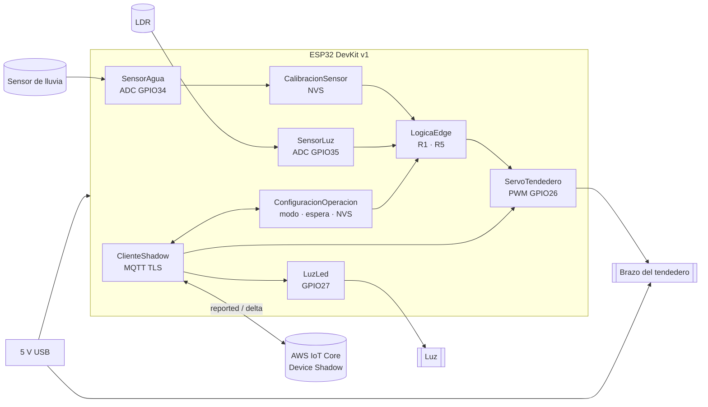

### 2.2 Diagrama de arquitectura del sistema

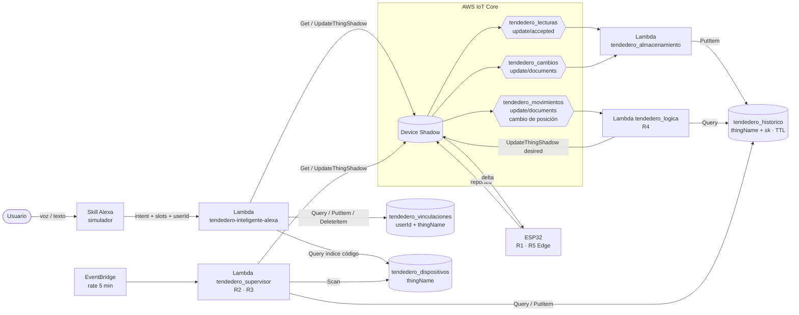

Alexa y la lógica de la Nube nunca hablan con el ESP32: toda orden pasa por `desired` del Shadow.

**Separación en reglas y funciones.** Almacenamiento y lógica de negocio van en Lambdas distintas por responsabilidad única, frecuencia de invocación y permisos:

| Función | Responsabilidad | Disparador | Frecuencia | Permisos mínimos |
|---|---|---|---|---|
| `tendedero-inteligente-alexa` | Backend de la Skill | Alexa | Por orden de voz | `iot:GetThingShadow`, `iot:UpdateThingShadow` sobre `thing/tendedero-*`; `dynamodb:Query/PutItem/DeleteItem` en vinculaciones; `Query` en el índice de dispositivos |
| `tendedero_almacenamiento` | Validar y guardar lecturas y eventos (RF11, RF12) | Reglas `tendedero_lecturas` y `tendedero_cambios` | Cada reporte (~2 por minuto) | `dynamodb:PutItem` en el histórico |
| `tendedero_logica` | R4 | Regla `tendedero_movimientos` (solo cambios de posición en automático) | Pocas veces al día | `dynamodb:Query` y `PutItem` en el histórico; `iot:UpdateThingShadow` |
| `tendedero_supervisor` | R2 y R3 | EventBridge `rate(5 minutes)` | 288 al día | `dynamodb:Scan` en dispositivos; `Query`/`PutItem` en el histórico; `iot:Get/UpdateThingShadow` |

Separarlas evita que la función que más se invoca (almacenamiento) tenga permiso para mover el actuador, y permite que R4 solo se invoque cuando hay un movimiento, lo que baja el costo. Políticas en [aws/iam/](../aws/iam).

### 2.3 Diagrama de circuito

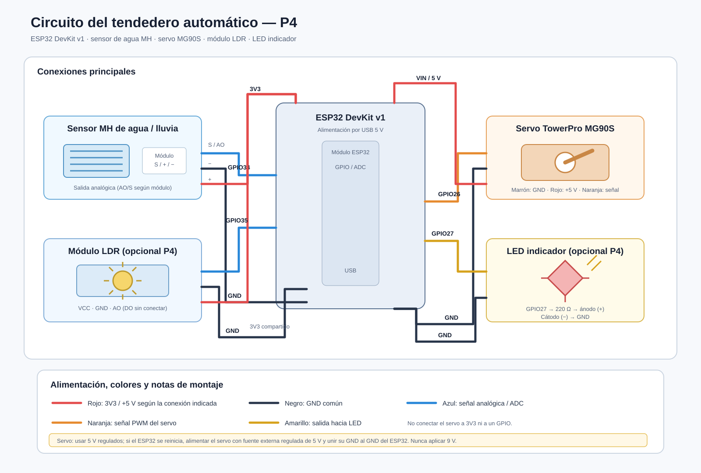

Conexiones detalladas en [CONEXIONES.md](../hardware/CONEXIONES.md) (sensor de agua y servo, sin cambios desde la P3) y [CONEXIONES_P4.md](../hardware/CONEXIONES_P4.md) (LDR en GPIO35 con divisor y LED en GPIO27 con resistencia). El servo se alimenta desde VIN (5 V del USB) con GND común. Foto del montaje: [montajeP4.jpeg](../referencias/montajeP4.jpeg).

### 2.4 Diagrama de clases del objeto inteligente

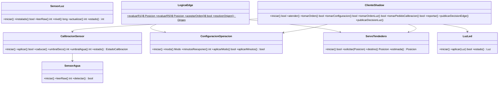

Código: [firmware/include/](../firmware/include) y [firmware/src/Tendedero.cpp](../firmware/src/Tendedero.cpp).

### 2.5 Diagrama de clases (módulos) de las Lambdas

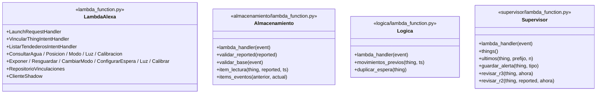

Cada Lambda es un módulo funcional con `lambda_handler(event, context)` y funciones puras para validar y decidir, separadas del acceso a AWS. Código: [lambda/](../lambda).

### 2.6 Secuencia: consulta del sensor

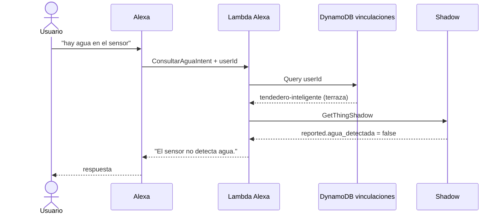

### 2.7 Secuencia: comando sobre el actuador

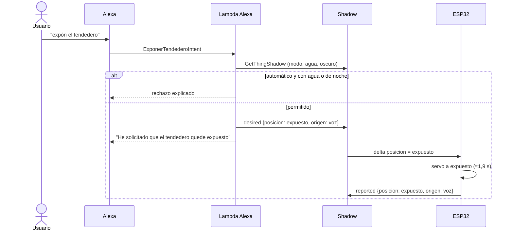

### 2.8 Secuencia: almacenamiento de un dato

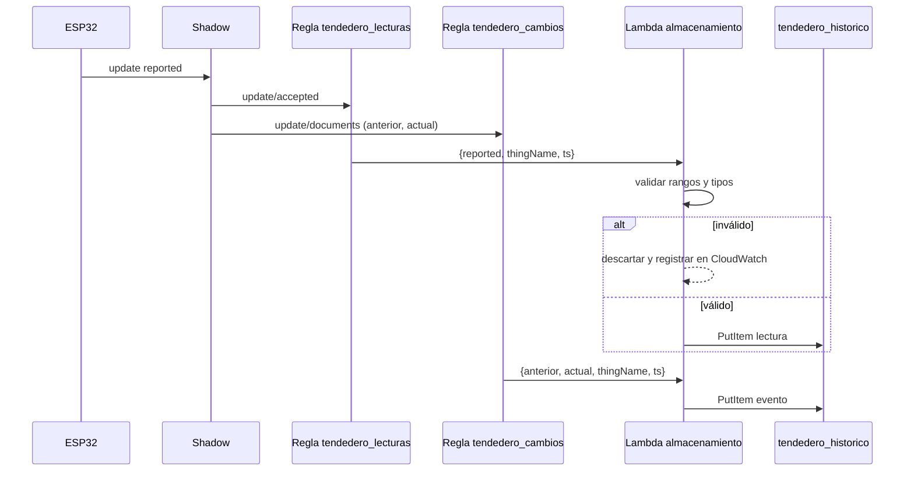

### 2.9 Secuencias de las reglas automáticas

**R1 y R5 (Edge), con y sin conexión:**

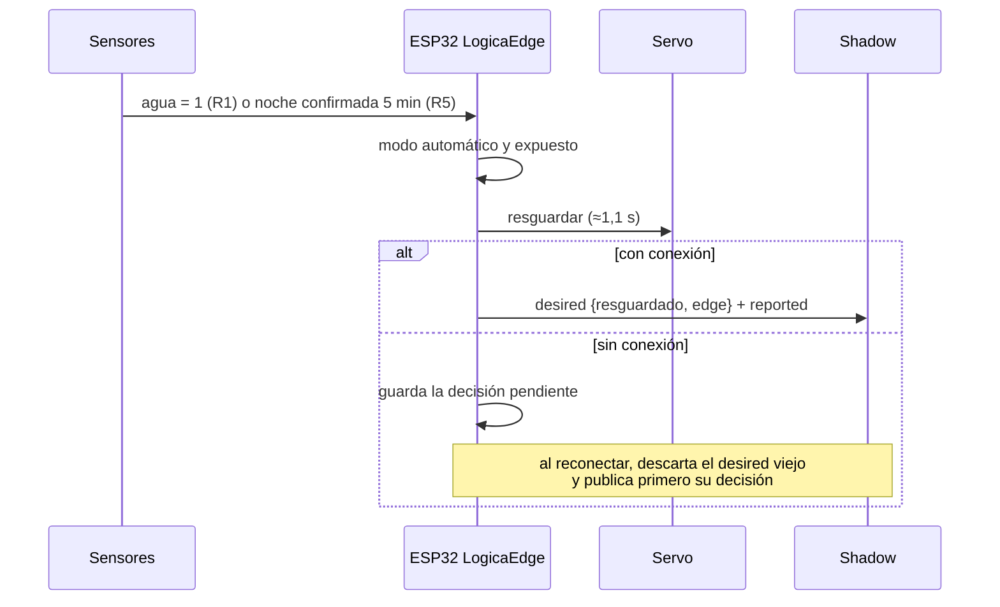

**R2 y R3 (Nube, programadas):**

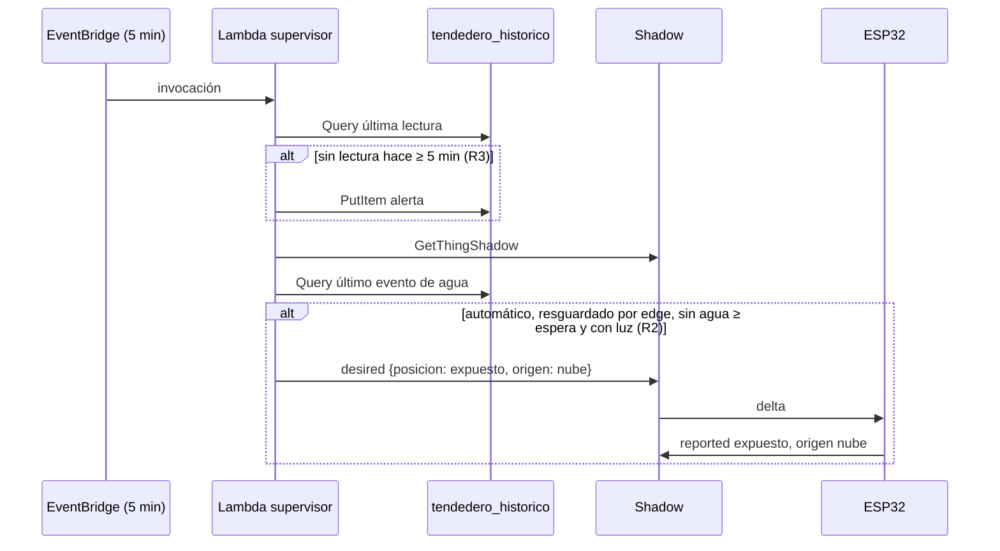

**R4 (Nube, por evento):**

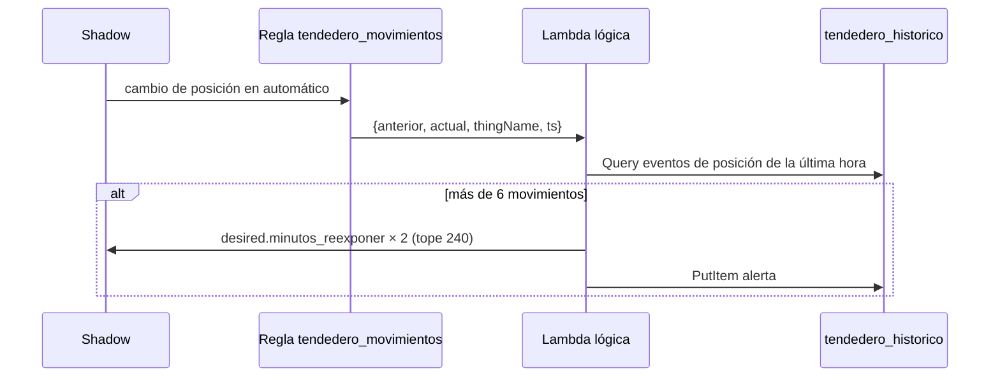

### 2.10 Lógica de control: estados y ubicación de cada regla

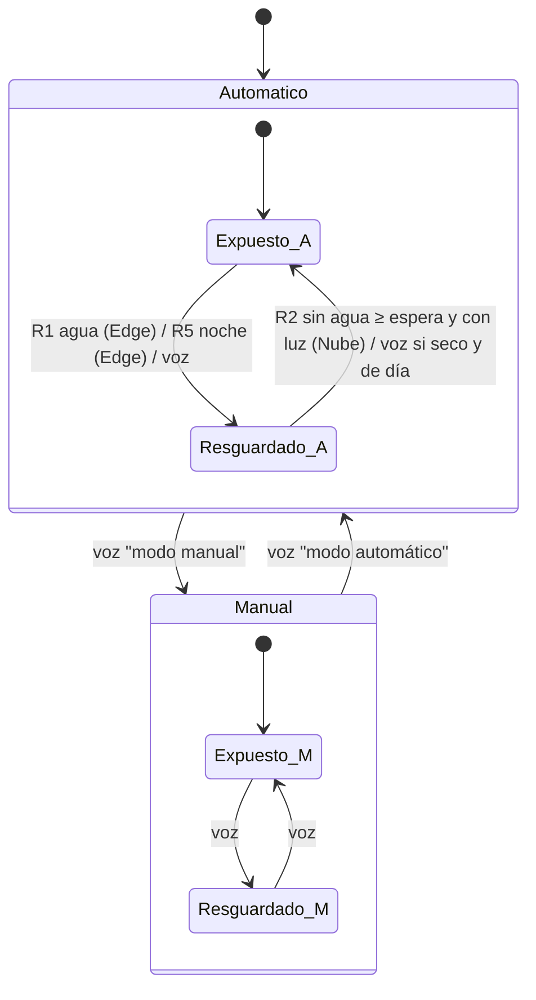

| Regla | Ubicación | Condición → acción | Justificación |
|---|---|---|---|
| R1 | Edge | Automático + agua → resguardar | Urgente (1,1 s), datos locales, debe funcionar sin Internet |
| R5 | Edge | Automático + noche confirmada 5 min → resguardar | Datos locales y funciona sin Internet; la confirmación evita que una nube cuente como noche |
| R2 | Nube | Automático + resguardado por el Edge + sin agua durante `minutos_reexponer` + luz → exponer | Usa el histórico de lluvia aunque el ESP32 se reinicie; no es urgente; la condición puede cambiar (p. ej. pronóstico) sin reprogramar el objeto |
| R3 | Nube | Sin reporte 5 min → alerta `sin_reporte` | El objeto no puede reportar su propia desconexión |
| R4 | Nube | > 6 movimientos en 1 h → duplica la espera y registra alerta | Necesita el histórico de movimientos |

**Convivencia de la voz con la lógica automática.** En modo `manual` la voz siempre manda y ninguna regla mueve el brazo. En modo `automatico`, «resguardar» siempre se cumple; «exponer» se rechaza con una explicación si hay agua o es de noche (Alexa 19 y 24), y si una orden llegara igual, el ESP32 la rechaza y reescribe su decisión con origen `edge`. R2 no deshace un resguardo pedido por voz (solo actúa si `origen = edge`). La luz no tiene regla automática, así que no hay conflicto. Detalle: [CONTRATO.md](practica4/CONTRATO.md#convivencia-de-la-voz-con-la-lógica-automática).

### 2.11 Especificación del documento Shadow

| Atributo | Tipo | Valores | Escribe | Uso |
|---|---|---|---|---|
| `desired.posicion` / `reported.posicion` | string | `expuesto`, `resguardado` | Alexa, supervisor (R2), ESP32 (R1, R5) / ESP32 | Orden y estado del brazo |
| `desired.origen` / `reported.origen` | string | `voz`, `nube`, `edge` | Quien escribe la posición / ESP32 | Origen del movimiento (RF12) |
| `desired.modo` / `reported.modo` | string | `manual`, `automatico` | Alexa / ESP32 (persistido en NVS) | Modo de operación (RF14) |
| `desired.minutos_reexponer` / `reported...` | entero | 15–240 (inicial 30) | Alexa, R4 / ESP32 | Parámetro de R2 (RF14) |
| `desired.led` / `reported.led` | string | `encendido`, `apagado` | Alexa / ESP32 | Luz para recoger la ropa |
| `reported.origen_led` | string | `voz`, `edge` | ESP32 | `edge` = apagado automático a los 10 min |
| `desired.calibracion_solicitada` | objeto | `{condicion: seco|mojado, id}` | Alexa | Pedido de calibración |
| `reported.calibracion` | objeto | `{umbral_seco, umbral_agua, estado}` | ESP32 | Resultado: `fabrica`, `aplicada`, `rechazada`, `caducada` |
| `reported.agua_detectada` | booleano | `true`, `false` | ESP32 | Consulta de Alexa, R1, R2 |
| `reported.lectura_adc` | entero | 0–4095 | ESP32 | Lectura cruda del sensor de agua |
| `reported.nivel_luz` | entero | 0–100 % | ESP32 | Luz ambiente normalizada (reporte B) |
| `reported.oscuro` | booleano | `true`, `false` | ESP32 | Noche confirmada (R5, R2) |

Uso de las secciones: `desired` lo escriben Alexa y la Nube (y el ESP32 para fijar las decisiones del Edge, de modo que un `desired` viejo no las deshaga); `reported` solo el ESP32; el `delta` lo aplica el ESP32 al conectar (GET) y en cada cambio. Especificación completa y reglas del `delta`: [CONTRATO.md](practica4/CONTRATO.md#documento-shadow).

### 2.12 Modelo de datos de DynamoDB

| Tabla | Clave de partición | Clave de ordenamiento | Índices | TTL | Capacidad |
|---|---|---|---|---|---|
| `tendedero_vinculaciones` | `userId` (S) | `thingName` (S) | — | — | Bajo demanda |
| `tendedero_dispositivos` | `thingName` (S) | — | GSI `codigoVinculacion-index` (`codigoVinculacion`) | — | Bajo demanda |
| `tendedero_historico` | `thingName` (S) | `sk` (S) | — | `ttl` (N, epoch s) | Aprovisionada 2/2 |

Ítems del histórico:

| Tipo | `sk` | Atributos | TTL |
|---|---|---|---|
| Lectura | `lectura#<ISO-8601 UTC>` | `lectura_adc` (N), `agua_detectada` (BOOL), `nivel_luz` (N), `oscuro` (BOOL), `ts_dispositivo`, `ts_iot`, `ts_guardado` (N, ms) | 30 días |
| Evento | `evento#<fecha>#<cambio>` (`posicion`, `agua`, `luz`, `modo`, `led`) | Nuevo valor, `origen`; los de posición guardan además `agua_detectada` y `oscuro` | 365 días |
| Alerta | `alerta#<fecha>#sin_reporte` o `#exceso_movimientos` | Detalle (`ultima_lectura`, `movimientos`) | 365 días |

| Patrón de acceso | Operación |
|---|---|
| Lecturas de un tendedero en un rango de fechas | `Query thingName = X AND sk BETWEEN lectura#desde AND lectura#hasta` |
| Eventos de un tendedero en un rango | `Query sk BETWEEN evento#desde AND evento#hasta` |
| Movimientos de la última hora (R4) | `Query sk > evento#<hace 1 h>` filtrando `cambio = posicion` |
| Último evento de agua (R2) y última lectura (R3) | `Query` descendente con `Limit` |
| Alertas de un tendedero | `Query sk BEGINS_WITH alerta#` |
| Tendederos de un usuario | `Query tendedero_vinculaciones userId = U` |
| Tendedero por código de la etiqueta | `Query` en `codigoVinculacion-index` |

No hacen falta índices en el histórico porque todos los reportes son de un tendedero en un rango de fechas. Definiciones: [aws/tendedero-historico.table.json](../aws/tendedero-historico.table.json), [aws/dynamodb-table.template.json](../aws/dynamodb-table.template.json), [aws/dynamodb-dispositivos.template.json](../aws/dynamodb-dispositivos.template.json).

### 2.13 Reglas de AWS IoT

| Regla | SQL | Acción |
|---|---|---|
| `tendedero_lecturas` | `SELECT state.reported AS reported, topic(3) AS thingName, timestamp() AS ts FROM '$aws/things/+/shadow/update/accepted' WHERE NOT isUndefined(state.reported)` | Lambda `tendedero_almacenamiento` (lectura) |
| `tendedero_cambios` | `SELECT current.state.reported AS actual, previous.state.reported AS anterior, topic(3) AS thingName, timestamp() AS ts FROM '$aws/things/+/shadow/update/documents' WHERE NOT isUndefined(current.state.reported)` | Lambda `tendedero_almacenamiento` (eventos) |
| `tendedero_movimientos` | `SELECT current.state.reported AS actual, previous.state.reported AS anterior, topic(3) AS thingName, timestamp() AS ts FROM '$aws/things/+/shadow/update/documents' WHERE previous.state.reported.posicion <> current.state.reported.posicion AND current.state.reported.modo = 'automatico'` | Lambda `tendedero_logica` (R4) |

`tendedero_cambios` no filtra en el SQL: la Lambda compara los documentos, porque comparar en el SQL perdía el primer valor de un campo ausente en el documento anterior. Definiciones: [aws/reglas/](../aws/reglas). Cada regla invoca su Lambda mediante un permiso basado en recursos (`lambda:InvokeFunction` para `iot.amazonaws.com`), sin rol propio.

### 2.14 Diseño de la Skill de Alexa

- **Invocación:** `tendedero inteligente` · idioma `es-MX` · endpoint: Lambda `tendedero-inteligente-alexa` (`us-east-2`).
- **Tipos propios:** `NombreTendedero` (patio, terraza, azotea…), `CondicionSensor` (seco / mojado), `Modo` (manual / automático).

| Intent | Slots | Frases de ejemplo |
|---|---|---|
| `VincularThingIntent` | `codigo` (AMAZON.NUMBER, con confirmación), `nombre` | «vincula mi tendedero con el código {codigo}» |
| `DesvincularThingIntent` | `nombre` | «desvincula mi tendedero» |
| `ListarTendederosIntent` | — | «qué tendederos tengo» |
| `ConsultarAguaIntent` | `nombre` | «hay agua en el sensor», «está lloviendo» |
| `ExponerTendederoIntent` / `ResguardarTendederoIntent` | `nombre` | «expón la ropa», «resguarda el tendedero del patio» |
| `ConsultarPosicionIntent` | `nombre` | «cómo está el tendedero» (con el motivo) |
| `CambiarModoIntent` | `modo`, `nombre` | «activa el modo automático» |
| `ConsultarModoIntent` | `nombre` | «en qué modo está» (modo y espera) |
| `ConfigurarEsperaIntent` | `minutos` (AMAZON.NUMBER), `nombre` | «espera {minutos} minutos para volver a exponer» |
| `CalibrarSensorIntent` / `ConsultarCalibracionIntent` | `condicion`, `nombre` | «calibra el sensor seco», «cómo está la calibración» |
| `EncenderLuzIntent` / `ApagarLuzIntent` / `ConsultarLuzIntent` | `nombre` | «enciende la luz», «cómo está la luz» |
| Integrados | — | Ayuda, cancelar, parar, fallback |

Con varios tendederos y sin nombre en la frase, la Lambda responde `Dialog.ElicitSlot` («¿En cuál tendedero?») y cumple la orden sin repetirla. Modelo: [alexa/interaction-model-es-MX.json](../alexa/interaction-model-es-MX.json); guía: [ALEXA.md](practica4/ALEXA.md).

### 2.15 Diseño de reportes (mockups)

Cuatro reportes para decisiones del usuario, con la consulta de DynamoDB de cada elemento en [MOCKUPS.md](practica4/MOCKUPS.md) ([HTML interactivo](practica4/mockups/reportes.html)):

| Reporte | Decisión que apoya | Datos y consulta |
|---|---|---|
| [A. Secado de la semana](practica4/mockups/reporte-a.png) | ¿La ropa recibió suficiente sol? | Eventos de posición y de luz de 7 días (`sk BETWEEN evento#…`); horas = diferencia entre eventos |
| [B. Mejor momento para tender](practica4/mockups/reporte-b.png) | ¿A qué hora tender? | Eventos de agua y `nivel_luz` de las lecturas de 30 días, agrupados por hora |
| [C. Protección](practica4/mockups/reporte-c.png) | ¿Puedo confiar en el modo automático? | Eventos de posición con `origen`, `agua_detectada` y `oscuro` |
| [D. Estado del equipo](practica4/mockups/reporte-d.png) | ¿Hay que revisar el Wi-Fi o la espera? | Alertas `sin_reporte` y `exceso_movimientos`, movimientos por día, deriva de `lectura_adc` |

---

## 3. Desarrollo e implementación

### 3.1 Estructura del código

| Módulo | Contenido |
|---|---|
| [firmware/src/Tendedero.cpp](../firmware/src/Tendedero.cpp) | Programa principal no bloqueante: lee sensores, evalúa R1/R5, aplica el `delta`, publica reportes por evento y cada 60 s, apaga el LED a los 10 min y reintenta la asociación Wi-Fi si el punto de acceso desaparece |
| [firmware/include/LogicaEdge.h](../firmware/include/LogicaEdge.h) | Reglas R1 y R5 como funciones puras (probadas en el host: [tests/firmware_host/](../tests/firmware_host)) |
| [firmware/include/CalibracionSensor.h](../firmware/include/CalibracionSensor.h) | Referencias seco / mojado en NVS, cálculo y validación de umbrales |
| [firmware/src/ClienteShadow.cpp](../firmware/src/ClienteShadow.cpp) | MQTT TLS, GET del Shadow al conectar, `delta`, publicación de `reported` y de las decisiones del Edge |
| [lambda/lambda_function.py](../lambda/lambda_function.py) | Backend de la Skill (ASK SDK): vinculación por código, varios tendederos, órdenes con validación de conflictos |
| [lambda/almacenamiento/](../lambda/almacenamiento/lambda_function.py) | Validación de rangos y tipos, descarte, lecturas y eventos con origen |
| [lambda/logica/](../lambda/logica/lambda_function.py) | R4 |
| [lambda/supervisor/](../lambda/supervisor/lambda_function.py) | R2 y R3 |

**Fragmentos clave.**
- *Decisión del Edge sin conexión:* si R1 actúa sin red, el ESP32 guarda la decisión y, al reconectar, descarta el `desired` distinto que trae el GET y publica primero `desired = {resguardado, edge}`; así una orden vieja no saca la ropa mojada (verificado en §4.7).
- *Reasociación Wi-Fi:* en la prueba con el hotspot apagado de verdad, el ESP32 quedaba en `WL_IDLE_STATUS` y no volvía solo. Se agregó un reintento cada `RECONEXION_WIFI_MS = 20 s` ([config.h](../firmware/include/config.h)).
- *Validación en almacenamiento:* `lectura_adc` fuera de 0..4095 o tipos incorrectos se descartan con un log en CloudWatch y no se guardan.
- *R4 sin carrera:* cuenta los movimientos guardados en la hora previa más el que trae el mensaje, porque la Lambda de almacenamiento lo guarda en paralelo.

### 3.2 Configuraciones en AWS

| Recurso | Configuración | Archivo |
|---|---|---|
| Things | `tendedero-inteligente` (físico, código 483920) y `tendedero-prueba2` (prueba, 715204), certificado X.509 por Thing, región `us-east-2` | [GUIA_AWS.md](practica4/GUIA_AWS.md) |
| Política de AWS IoT | `iot:Connect` con `clientId = ${iot:Connection.Thing.ThingName}`; `Publish`/`Subscribe`/`Receive` solo sobre `$aws/things/${iot:Connection.Thing.ThingName}/shadow/*` | [aws/iot-certificate-policy.template.json](../aws/iot-certificate-policy.template.json) |
| Reglas | 3 reglas de §2.13 | [aws/reglas/](../aws/reglas) |
| Lambdas | 4 funciones, Python 3, un rol por función | [lambda/](../lambda), [aws/cloudformation/tendedero-p4.yaml](../aws/cloudformation/tendedero-p4.yaml) |
| EventBridge | `rate(5 minutes)` → supervisor | Evidencia [09-eventbridge.jpg](evidencias/p4/aws/09-eventbridge.jpg) |
| DynamoDB | 3 tablas de §2.12, TTL en el histórico | [aws/](../aws) |
| IAM | Un rol por Lambda con permisos sobre recursos concretos | [aws/iam/](../aws/iam), [aws/lambda-iam-policy.template.json](../aws/lambda-iam-policy.template.json) |
| Facturación | Presupuesto *Zero-Spend* con aviso por correo | [13-facturacion.jpg](evidencias/p4/aws/13-facturacion.jpg) |

**Permisos asignados y mínimos.** Las políticas del repositorio ya aplican el mínimo privilegio: cada rol solo tiene las acciones de la tabla de §2.2, sobre ARN concretos de tablas y sobre `thing/tendedero-*`, más `logs:CreateLogStream/PutLogEvents`. La única ampliación es el comodín `tendedero-*` en los Things, que permite agregar tendederos sin editar políticas; en producción se mantendría, porque el prefijo ya limita el alcance. Las reglas no tienen rol: invocan su Lambda con un permiso basado en recursos limitado al ARN de la regla. Ninguna función ni el firmware contienen *access keys*: las Lambdas usan su rol y el ESP32 su certificado.

**Secretos.** `secrets.h`, `calibracion_local.h`, `luz_local.h`, certificados y claves están en `.gitignore`, con plantillas `*.example.h` sin valores reales. Las capturas tienen tapados el número de cuenta y el Skill ID.

### 3.3 Configuraciones en Alexa

Modelo de interacción importado en el JSON Editor y compilado sin errores el 24/11/2026; endpoint de tipo AWS Lambda ARN apuntando a `tendedero-inteligente-alexa`, con disparador Alexa Skills Kit restringido al Skill ID. Evidencias de configuración: capturas 01 a 08 de [evidencias/p4/alexa/](evidencias/p4/alexa/README.md).

---

## 4. Pruebas y validaciones

### 4.1 Plan y método

| Nivel | Qué verifica | Herramienta | Evidencia |
|---|---|---|---|
| Pruebas locales | Lambdas con AWS simulado, lógica Edge en el host, contrato, herramientas | `py -B -m unittest discover -s tests` (149 pruebas) | [tests/](../tests) |
| Skill en el simulador | RF4–RF9, RF14, convivencia voz / automático, varios tendederos | Alexa Developer Console (Development, es-MX) | [evidencias/p4/alexa/](evidencias/p4/alexa/README.md) |
| AWS desde la consola | Lambdas, reglas y almacenamiento de punta a punta | Pestaña Test de Lambda y MQTT test client | [pruebas-aws-consola.md](../resultados_p4/pruebas-aws-consola.md), [evidencias/p4/aws/](evidencias/p4/aws/README.md) |
| ESP32 | Arranque, órdenes, persistencia, frecuencia, calibración, sensor, Edge, luz, reconexión, sin conexión, R3 | `tools/probar_esp32.py`, `tools/grabar_rnf.py` | [resultados_p4/](../resultados_p4) |
| RNF de la Nube | Integridad, latencia, R2, costo | `tools/medir_almacenamiento.py`, `tools/estimar_costo.py` | [07-20-almacenamiento.txt](../resultados_p4/07-20-almacenamiento.txt), [tiempo_respuesta_regla.md](../resultados_p4/tiempo_respuesta_regla.md), [costo.md](../resultados_p4/costo.md) |
| Demostración | Integración completa | Video | [evidencias/p4/demo/](evidencias/p4/demo) |

### 4.2 Skill de Alexa (simulador)

30 de 30 pruebas pasan. Detalle por frase en [evidencias/p4/alexa/README.md](evidencias/p4/alexa/README.md).

| Requisito | Pruebas | Resultado |
|---|---|---|
| RF4 consulta del sensor | 16, 24, 36 | PASA |
| RF5 órdenes (servo y LED) | 18, 25, 30, 31, 35 | PASA |
| RF6 estado de actuadores | 17, 32 | PASA |
| RF7 vinculación por código y persistencia | 12, 13, 15, 33 | PASA |
| RF8 usuario sin vínculo | 11 | PASA |
| RF9 validación y eliminación | 13, 14, 37, 38, 39 | PASA |
| RF14 modo y espera por voz | 20, 21, 22, 23 | PASA |
| Convivencia voz / automático | 19 (noche), 24 (lluvia), 25 (manual) | PASA |
| Calibración | 26–29 | PASA |

### 4.3 Objeto inteligente (ESP32)

| Prueba | Corrida | Resultado |
|---|---|---|
| Arranque, 10 órdenes, persistencia, frecuencia 15 min | [20261124-141828](../resultados_p4/20261124-141828/resumen.md) | 10/10 ciclos; servo media 1857 ms, máx. 2814 ms; frecuencia máx. 61,7 s; umbrales conservados tras reinicio |
| Calibración seco / mojado / repetición | [20261124-001738](../resultados_p4/20261124-001738/resumen.md) | 4/4 PASA |
| Exactitud del sensor | [20261124-101706](../resultados_p4/20261124-101706/resumen.md) | 19/20 (5,0 %) |
| Estabilidad con firmware de producción | [estabilidad-produccion.csv](../resultados_p4/estabilidad-produccion.csv) | 10,6 min sin reinicios |

### 4.4 Lógica automática

| Regla | Corrida | Resultado |
|---|---|---|
| R1 y conflicto con la voz | [20261124-004618](../resultados_p4/20261124-004618/resumen.md) | 7/7: resguarda en 1088 ms, escribe `desired` con origen `edge`, rechaza «exponer» en automático, la cumple en manual |
| R5 | [20261124-104413](../resultados_p4/20261124-104413/resumen.md) | 8/8: resguarda en 228,6 s con origen `edge` |
| LED apagado automático | [sesion-bloques-4.csv](../resultados_p4/sesion-bloques-4.csv) | Encendido 01:21:14, apagado `origen=edge` 01:31:14 (10 min exactos) |
| R2 | [tiempo_respuesta_regla.md](../resultados_p4/tiempo_respuesta_regla.md) | Expone con origen `nube` 51 s después de cumplir 15 min sin agua |
| R3 | [20261124-133852](../resultados_p4/20261124-133852/resumen.md) | Alerta `sin_reporte` a los 5,1 min; vuelve a reportar al recuperar la red |
| R4 | AWS prueba 16 (consola) | Cuenta los movimientos de la última hora sin errores de permisos; con 3 movimientos no actúa |

### 4.5 Almacenamiento (RF10–RF12)

| Prueba | Resultado |
|---|---|
| Regla de lecturas por MQTT (AWS 18) | 1 lectura sin posición ni modo |
| Regla de cambios (AWS 19) | Lectura + evento de agua + evento de posición con `origen = edge`; también disparó R4 |
| Mensaje inválido (AWS 15 y 20) | `lectura_adc = 9999` descartado, registrado en CloudWatch |
| Integridad y latencia, 16,3 min con el ESP32 ([07-20-almacenamiento.txt](../resultados_p4/07-20-almacenamiento.txt), [lecturas.csv](../resultados_p4/lecturas-almacenamiento.csv)) | 100 % de los reportes guardados; latencia máx. 2,0 s |

### 4.6 Costo

`tools/estimar_costo.py` con 1 tendedero, respaldo cada 60 s, 20 eventos y 10 órdenes por día: 88 500 mensajes (17,7 % de la capa gratuita), 131 400 reglas disparadas (52,6 %), 97 140 invocaciones de Lambda (9,7 %). Detalle en [costo.md](../resultados_p4/costo.md).

### 4.7 Reconexión y operación sin conexión

| Prueba | Evidencia | Resultado |
|---|---|---|
| Reconexión con orden pendiente (`wifi_off`) | [20261124-015854](../resultados_p4/20261124-015854/resumen.md) | Reconecta en 5,9 / 7,1 / 6,5 s. El intento 3 aplica la orden pendiente. El 1 se hizo en automático con el sensor mojado: R1 prevaleció sobre la orden, como está diseñado |
| R1 sin red (`wifi_off`) | [20261124-020713/log.csv](../resultados_p4/20261124-020713/log.csv) | `wifi_off` 02:07:47 → `[EDGE] R1 … resguardando` 02:07:51 y servo `origen=edge` sin red; al volver publica la decisión pendiente (7,6 s) y el `desired` viejo no saca la ropa |
| Hotspot apagado de verdad | [sesion-ap-apagado-2.csv](../resultados_p4/sesion-ap-apagado-2.csv) | `ap_off` 15:07:16 → R1 resguarda sin red 15:08:00. Al encender el hotspot el ESP32 no se reasociaba (defecto); corregido con la reasociación cada 20 s: Wi-Fi 15:17:19, Shadow recuperado 15:17:54 y decisión del Edge publicada |

### 4.8 Errores encontrados y análisis

| Problema | Causa | Tratamiento |
|---|---|---|
| Reconexión real fallaba con el hotspot apagado | `setAutoReconnect` deja la estación en `WL_IDLE_STATUS` | Reasociación explícita cada 20 s en el firmware |
| R5 fallaba en algunas corridas (01:53, 10:34) | El ESP32 arrancó con poca luz y la primera lectura lo clasificó como noche | Las pruebas arrancan con luz sobre el LDR; mejora recomendada en §7 |
| 1 de 10 órdenes sin `delta` (23/11) | Caída breve de MQTT en ese instante | Repetido el 24/11: 10/10 |
| Intervalo de 134,5 s (21/11) | Caída de MQTT con reconexión en 11 s | La prueba separa los intervalos con caída; R3 tolera 5 min |
| Sensor 10 % de error (00:16) | Umbrales previos a la calibración | Tras recalibrar: 5,0 % |
| R3 a 13,7 min en una corrida | La hora se tomó al Enter manual, no al ver la alerta | Repetido: 5,1 min |
| Reconexión intento 2: `delta` sin posición | La orden pendiente no quedó en `desired.posicion` antes del corte | Intento 3 con la orden confirmada en el Shadow: PASA |

---

## 5. Resultados

| Indicador | Valor |
|---|---|
| Pruebas locales | 149 (todas pasan con este informe; 15 se omiten sin AWS) |
| Skill en el simulador | 30/30 |
| AWS desde la consola | 25/25 |
| Integridad / latencia del almacenamiento | 100 % / máx. 2,0 s (media 0,9 s) |
| Respuesta Edge (R1 / R5) | 1,09 s / 228,6 s |
| Respuesta Nube (R2 / R3) | 51 s / 5,1 min |
| Orden → servo | Media 1,86 s, máx. 2,81 s |
| Frecuencia de reporte | Máx. 61,7 s |
| Reconexión | 5,9–7,1 s (con `wifi_off`); ~35 s Wi-Fi → Shadow tras el corte real |
| Costo | USD 0,21–1,37 / mes; 53 % del límite gratuito de reglas |

**Datos almacenados en DynamoDB.** En la ventana de 16,3 min se guardaron 39 lecturas de `tendedero-inteligente` ([lecturas.csv](../resultados_p4/lecturas-almacenamiento.csv)); el histórico contiene además eventos de agua y posición con su origen (`edge`, `voz`, `nube`) y alertas `sin_reporte` de R3 ([03](evidencias/p4/aws/03-historico-lecturas.jpg), [04](evidencias/p4/aws/04-historico-eventos.jpg), [05](evidencias/p4/aws/05-historico-alertas.jpg), [25](evidencias/p4/aws/25-historico-lectura-y-eventos.jpg)).

**Análisis Edge / Nube.** Las reglas que protegen la ropa (R1, R5) quedaron en el Edge y respondieron en 1,1 s incluso sin red; si R1 dependiera de la Nube, la respuesta sumaría la regla, la Lambda y el `delta` (≈2–3 s) y no funcionaría sin Internet. R2 en la Nube tarda hasta 5 min por el período del supervisor (51 s medidos), lo que es aceptable porque exponer la ropa un poco tarde no la daña, y a cambio usa el histórico y se puede cambiar sin reprogramar. R3 solo puede estar en la Nube. El precio de la Nube es costo de invocaciones, y la mayor parte del consumo son las reglas de almacenamiento, no la lógica.

---

## 6. Conclusiones

- El sistema cumple RF1–RF15: el tendedero se protege solo de la lluvia y de la noche, vuelve a exponer la ropa cuando corresponde, guarda un histórico consultable por tendedero y se controla por voz con modo y parámetros ajustables.
- Repartir la lógica según la urgencia funcionó: lo que protege la ropa está en el Edge y sigue operando sin Internet; lo que necesita histórico o no puede detectar el objeto está en la Nube.
- Separar almacenamiento y lógica en reglas y Lambdas distintas dio permisos mínimos por función y redujo invocaciones: R4 solo se ejecuta con cambios de posición.
- Modelar el histórico a partir de los reportes (y no de los mensajes) permitió resolver todos los patrones de acceso con una sola tabla, sin índices secundarios y con TTL para limitar el volumen.
- Las pruebas con el equipo real encontraron defectos que la simulación no mostraba (reasociación Wi-Fi tras un corte real, arranque en modo noche); el primero ya está corregido.
- Con un tendedero, el consumo queda dentro de la capa gratuita y el costo estimado es menor a USD 1,40 al mes.

## 7. Recomendaciones

- **Arranque del LDR:** no decidir día / noche con la primera lectura; esperar unos segundos de lecturas estables, como ya se hace para confirmar la noche.
- **R2 más rápida:** reducir el período del supervisor (p. ej. 1 min) o disparar R2 con el evento de agua = `false` y un temporizador, si el usuario necesita una respuesta menor a 5 min.
- **Datos sin conexión:** guardar en el ESP32 los cambios de estado mientras no hay red y enviarlos al reconectar, para no perder eventos del histórico.
- **Aprovisionamiento:** usar Fleet Provisioning para dar de alta tendederos sin crear certificados a mano, y un botón físico para habilitar la vinculación unos minutos (prueba de posesión).
- **Hacia un uso real:** tira LED de 12 V, servo o motor con más torque y caja estanca; pronóstico del clima como dato externo de R2; notificaciones de Alexa cuando R3 detecta una desconexión; implementar los reportes de los mockups como panel web.
- **Escala:** con muchos tendederos, pasar el histórico a capacidad bajo demanda y agregar un proceso de agregación diaria para los reportes globales.

## 8. Anexos

| Anexo | Contenido |
|---|---|
| [CAMBIOS.md](practica4/CAMBIOS.md) | Cambios respecto a la práctica 3 y su justificación |
| [CONTRATO.md](practica4/CONTRATO.md) | Contrato completo: Shadow, lógica, tablas, intents |
| [GUIA_AWS.md](practica4/GUIA_AWS.md) · [PRUEBAS_AWS.md](practica4/PRUEBAS_AWS.md) | Configuración y pruebas de AWS paso a paso |
| [ALEXA.md](practica4/ALEXA.md) · [alexa/interaction-model-es-MX.json](../alexa/interaction-model-es-MX.json) | Skill y modelo exportado |
| [MOCKUPS.md](practica4/MOCKUPS.md) | Mockups de reportes y sus consultas |
| [aws/](../aws) | Política de IoT, reglas, roles IAM, tablas, CloudFormation, eventos de prueba |
| [hardware/](../hardware) · [montajeP4.jpeg](../referencias/montajeP4.jpeg) | Circuito, conexiones y foto del montaje |
| [evidencias/p4/alexa/](evidencias/p4/alexa/README.md) | 40 capturas de la Skill |
| [evidencias/p4/aws/](evidencias/p4/aws/README.md) | Capturas de AWS y muestras de DynamoDB |
| [evidencias/p4/demo/](evidencias/p4/demo) | Videos de la demostración (servo y luces) |
| [evidencias/p4/pruebas/](evidencias/p4/pruebas) | Capturas tomadas durante los ensayos con el ESP32 (Shadow, simulador, DynamoDB) |
| [resultados_p4/](../resultados_p4) | Resúmenes y logs del ESP32, almacenamiento, R2, costo |
| [tools/](../tools/README.md) | Scripts de prueba y medición |
