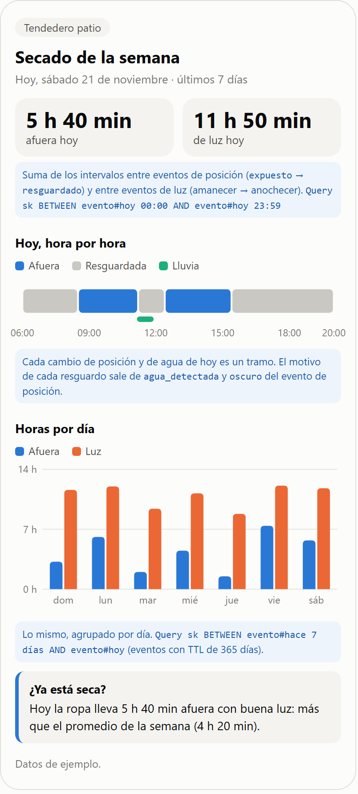
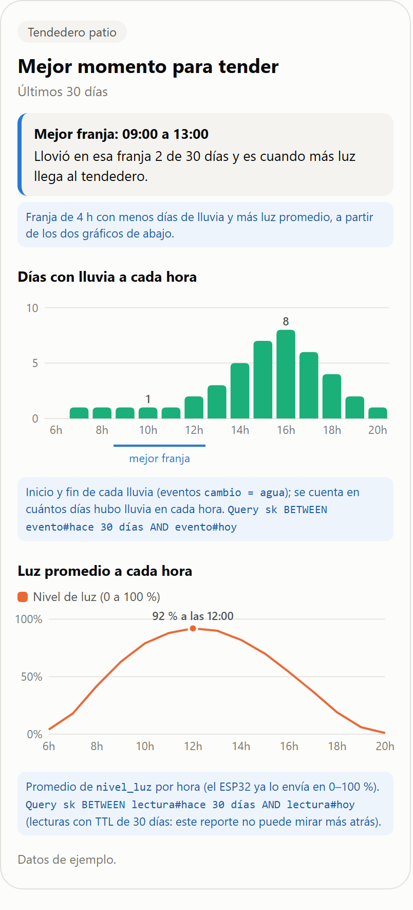
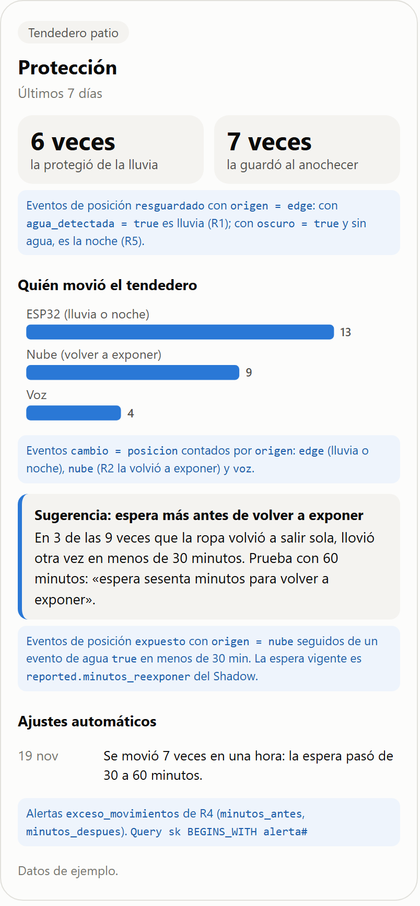
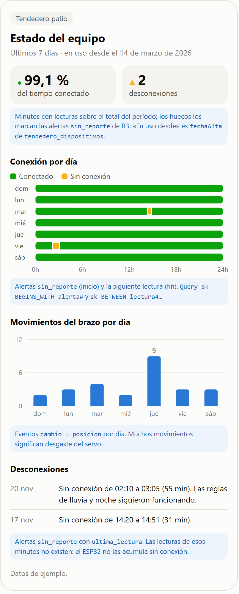

# Mockups de los reportes (RF15)

Diseño de los reportes para el **usuario del tendedero**: la persona que lo tiene en su casa. No se implementan; el modelo de datos de DynamoDB permite obtener todo lo que muestran ([CONTRATO.md](CONTRATO.md#modelo-del-histórico-rf11-rf12-rf15)).

- **Datos de ejemplo.** Los valores son ficticios y coherentes entre los cuatro reportes.
- **Página interactiva:** [mockups/reportes.html](mockups/reportes.html). Al pasar el mouse por un gráfico se ven sus valores. Abrirla con `#a`, `#b`, `#c` o `#d` muestra un solo reporte.
- **Cuándo se calculan:** al abrirlos. Cada reporte consulta `tendedero_historico` del tendedero elegido en el período que muestra. No hay procesos programados ni resúmenes guardados.
- **Varios tendederos:** el usuario elige el tendedero arriba (el recuadro «Tendedero patio»). La lista sale de `tendedero_vinculaciones` (`Query` por `userId`), con el nombre que le dio al vincularlo.

En las tablas, «Consulta» es la operación sobre `tendedero_historico` con `thingName` = el tendedero elegido.

## A. Secado de la semana

**Decisión:** ¿ya está seca la ropa o conviene dejarla más tiempo?

| Elemento | Consulta | Cálculo |
|---|---|---|
| Horas afuera hoy | `sk BETWEEN evento#<hoy 00:00> AND evento#<hoy 23:59>` | Suma de los intervalos entre un evento de posición `expuesto` y el siguiente `resguardado` |
| Horas de luz hoy | La misma | Intervalo entre el evento de luz `oscuro = false` (amanecer) y el siguiente `oscuro = true` (anochecer) |
| Línea de hoy | La misma | Un tramo por cada evento de posición; las marcas de lluvia son los eventos de agua. El motivo de cada resguardo sale de `agua_detectada` y `oscuro` del evento de posición |
| Horas por día | `sk BETWEEN evento#<hace 7 días> AND evento#<hoy>` | Los mismos cálculos, agrupados por día |
| «¿Ya está seca?» | La misma | Horas afuera de hoy comparadas con el promedio de los 7 días |

## B. Mejor momento para tender

**Decisión:** a qué hora tender la ropa.

| Elemento | Consulta | Cálculo |
|---|---|---|
| Días con lluvia a cada hora | `sk BETWEEN evento#<hace 30 días> AND evento#<hoy>`, eventos `cambio = agua` | Para cada hora, en cuántos días hubo lluvia (entre un evento `agua_detectada = true` y el siguiente `false`) |
| Luz promedio a cada hora | `sk BETWEEN lectura#<hace 30 días> AND lectura#<hoy>` | Promedio de `nivel_luz` por hora (el ESP32 ya lo envía en 0–100 %) |
| Mejor franja | Las dos anteriores | Franja de 4 h con menos días de lluvia y más luz promedio |

Las lecturas se guardan 30 días (TTL), así que este reporte no puede mirar más atrás. Es el único que usa lecturas: los demás usan eventos, que se guardan un año.

## C. Protección

**Decisión:** confiar en el modo automático o ajustar la espera antes de volver a exponer.

| Elemento | Consulta | Cálculo |
|---|---|---|
| Veces que la protegió de la lluvia | `sk BETWEEN evento#<hace 7 días> AND evento#<hoy>`, eventos `cambio = posicion` | `resguardado` con `origen = edge` y `agua_detectada = true` (R1) |
| Veces que la guardó al anochecer | La misma | `resguardado` con `origen = edge`, `oscuro = true` y sin agua (R5) |
| Quién movió el tendedero | La misma | Eventos de posición contados por `origen`: `edge`, `nube` (R2), `voz` |
| Sugerencia de espera | La misma, más los eventos `cambio = agua` | `expuesto` con `origen = nube` seguido de un evento de agua `true` en menos de 30 min. Si pasa seguido, se sugiere subir `minutos_reexponer` (se lee del Shadow) |
| Ajustes automáticos | `sk BEGINS_WITH alerta#` | Alertas `exceso_movimientos` de R4, con `minutos_antes` y `minutos_despues` |

## D. Estado del equipo

**Decisión:** revisar el Wi-Fi o el mecanismo del brazo.

| Elemento | Consulta | Cálculo |
|---|---|---|
| Tiempo conectado | `sk BEGINS_WITH alerta#` y `sk BETWEEN lectura#<hace 7 días> AND lectura#<hoy>` | Minutos sin conexión: desde cada alerta `sin_reporte` (R3, con `ultima_lectura`) hasta la siguiente lectura. Se restan del total del período |
| Conexión por día | Las mismas | Los mismos huecos, dibujados en una barra de 24 h por día |
| Movimientos del brazo por día | `sk BETWEEN evento#<hace 7 días> AND evento#<hoy>` | Eventos `cambio = posicion` por día. Muchos movimientos significan desgaste del servo |
| Desconexiones | `sk BEGINS_WITH alerta#` | Lista de alertas `sin_reporte`. Las lecturas de esos minutos no existen: el ESP32 no las acumula sin conexión |
| «En uso desde» | `GetItem` en `tendedero_dispositivos` | `fechaAlta` del tendedero |

## Qué no está y por qué

- **Reportes para la empresa** (todos los tendederos juntos): la tabla está organizada por tendedero. Haría falta un índice o un proceso de agregación. Queda como recomendación.
- **Tiempo de reacción de R1 en el reporte:** la lluvia y el movimiento suelen llegar en el mismo reporte del ESP32 y quedan con la misma fecha en el histórico. El tiempo de reacción se mide en las pruebas con el monitor serie (`tools/probar_esp32.py edge`), no en este reporte.
- **Uso de la luz para recoger la ropa:** sus eventos se guardan (RF12), pero no ayudan a ninguna decisión del usuario, así que no tiene reporte.
