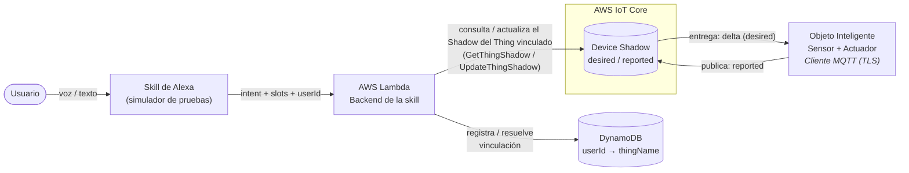

# Práctica 3 — Integración de Objetos Inteligentes con Alexa y AWS IoT Core

**Carrera:** Ingeniería de Sistemas
**Asignatura:** SIS-234
**Modalidad:** grupos de 2 o 3 integrantes
**Fecha límite de entrega:** martes 10 de noviembre de 2026, 17:45

---

## 1. Nombre de la Actividad Evaluativa

**Integración de un objeto inteligente con Alexa mediante MQTT y AWS IoT Core.**

---

## 2. Propósito de la Actividad Evaluativa

Evaluar el desarrollo de los siguientes saberes:

### 2.1 Saber Conceptual
- Librerías y plataformas en la nube para el IoT: AWS IoT Core y Device Shadow (estado deseado y estado reportado).
- Herramientas de IA: Amazon Alexa (skills, intents y slots).

### 2.2 Saber Procedimental
- Implementa protocolos de aplicación con integración en la nube: MQTT sobre TLS.
- Implementa sistemas integrados con plataformas en la nube: AWS IoT Core, AWS Lambda y Alexa.

### 2.3 Saber Actitudinal (Saber Ser)
- Disposición a realizar prácticas y ejercicios en equipo.
- Responsabilidad en sus asignaciones y prácticas.
- Orden, sistematicidad y disciplina durante el análisis, diseño y construcción del prototipo.

---

## 3. Descripción de la Actividad

Se deberá diseñar e implementar un sistema distribuido compuesto por:

- **1 Objeto Inteligente** con un MCU con conectividad WiFi, **mínimo 1 sensor y 1 actuador**, registrado como *Thing* en **AWS IoT Core** y sincronizado mediante su **Device Shadow**.
- **1 skill de Alexa (frontend)**, utilizada a través del **simulador de pruebas** de la Alexa Developer Console.
- **1 función AWS Lambda (backend de la skill)**, que consulta y modifica el Shadow del objeto inteligente vinculado a cada usuario.
- **1 almacenamiento persistente** para el registro de vinculaciones usuario ↔ *Thing* (se sugiere **Amazon DynamoDB**, por estar incluido en la capa gratuita de AWS).

La skill **no debe estar atada a un único *Thing***: debe poder atender a distintos usuarios de Alexa, cada uno con su propio objeto inteligente (ver §3.1, *Vinculación*).

El objeto inteligente debe resolver un **caso de uso práctico y real**, definido por el grupo, en el que el sensor y el actuador tengan una función coherente con ese caso de uso. El prototipo debe concebirse de modo que, a futuro, pueda extenderse con más sensores y actuadores sin rediseñar su arquitectura.

**Restricciones sobre los componentes:**

- **No se permite utilizar LEDs como actuadores.**
- El **sensor ultrasónico** solo puede utilizarse si el caso de uso lo requiere (p. ej. medición del nivel de un tanque), y su uso debe justificarse en el informe.
- Por seguridad, los actuadores deben operar a **baja tensión (≤ 12 V DC)**; no se permite conmutar cargas de 220 V AC.



> Alexa nunca se comunica directamente con el objeto inteligente: toda interacción pasa por el Shadow en AWS IoT Core. El diagrama es referencial: cada grupo debe elaborar su propio diagrama de arquitectura y de secuencia (§4.2).

> **Lógica de control:** en esta práctica el actuador se controla **únicamente por comandos de voz** a través del Shadow; no se exige una lógica de control automática local (sensor → actuador). El sensor se reporta al Shadow para ser consultado desde Alexa.

### 3.1 Requerimientos Funcionales Mínimos

El sistema deberá cumplir, como mínimo, con los siguientes requerimientos:

**Objeto Inteligente**

- **RF1.** Capturar datos del entorno con su sensor.
- **RF2.** Reportar periódicamente el valor del sensor y el estado del actuador en la sección `reported` de su Shadow.
- **RF3.** Recibir los cambios del estado deseado (`delta` del Shadow), aplicarlos sobre el actuador y confirmar el nuevo estado en `reported`.

**Alexa (skill y backend Lambda)**

- **RF4.** Responder, en español, consultas por voz sobre el valor actual del sensor, leyendo la sección `reported` del Shadow del *Thing* vinculado al usuario.
- **RF5.** Ejecutar comandos por voz sobre el actuador, modificando la sección `desired` del Shadow del *Thing* vinculado al usuario.
- **RF6.** Responder consultas por voz sobre el estado actual del actuador del *Thing* vinculado al usuario.

**Vinculación usuario ↔ objeto inteligente**

- **RF7.** Permitir que el usuario de Alexa **vincule su objeto inteligente** mediante un identificador del *Thing* (p. ej. su *thing name*, un número de serie o un código de vinculación), y que la vinculación **persista** entre sesiones.
- **RF8.** Resolver, en cada solicitud, el *Thing* asociado al usuario a partir del identificador de usuario que envía Alexa en la solicitud (`context.System.user.userId`); si el usuario aún no tiene un objeto vinculado, la skill debe indicárselo y guiarlo para vincularlo.
- **RF9.** Validar que el *Thing* indicado exista en AWS IoT Core antes de registrar la vinculación, y permitir **cambiar o eliminar** la vinculación.

La vinculación se almacena en una base de datos; se sugiere **Amazon DynamoDB** por su capa gratuita y su integración directa con Lambda, aunque se acepta otra alternativa justificada.

**Ejemplo — tabla de vinculaciones en DynamoDB:**

| `userId` (clave de partición) | `thingName` | `fechaVinculacion` |
|-------------------------------|-------------|--------------------|
| `amzn1.ask.account.AF3X...` | `maceta-grupo3-01` | `2026-11-06T10:15:00Z` |
| `amzn1.ask.account.B72K...` | `maceta-grupo3-02` | `2026-11-06T10:22:00Z` |

> Se recomienda (no es obligatorio) que el identificador usado para vincular no sea trivial de adivinar —p. ej. un código de vinculación que el objeto publica en su Shadow o muestra al iniciar—, para evitar que un usuario vincule un objeto ajeno. La implementación de *Account Linking* (OAuth) de Alexa queda fuera del alcance de esta práctica.

Cada grupo deberá **definir y documentar su caso de uso, la estructura de su documento Shadow, el mecanismo de vinculación y el modelo de interacción de su skill** (invocación, intents, slots y frases de ejemplo) en el informe. Las tablas siguientes son únicamente **ejemplos ilustrativos**.

**Ejemplo — casos de uso:**

| Caso de uso | Sensor | Actuador |
|-------------|--------|----------|
| Riego de una maceta | Humedad de suelo | Mini bomba de agua (relé o MOSFET) |
| Ventilación de un ambiente | Temperatura y humedad (DHT22) | Ventilador DC |
| Control de una persiana | Luz (LDR o BH1750) | Servomotor |
| Cerradura de una puerta | Sensor magnético (reed switch) | Cerradura solenoide |
| Llenado de un tanque | Ultrasónico (nivel de agua) | Mini bomba de agua |

**Ejemplo — documento Shadow (caso de riego):**

```json
{
  "state": {
    "desired":  { "bomba": "on" },
    "reported": { "humedad_suelo": 37.5, "bomba": "off" }
  }
}
```

**Ejemplos de instrucciones en lenguaje natural** que la skill debe poder atender (caso de riego):

- _"Alexa, abre riego inteligente."_
- _"Vincula mi maceta con el código maceta grupo tres cero uno."_
- _"¿Cuál es la humedad del suelo?"_
- _"Enciende la bomba."_
- _"¿La bomba está encendida?"_
- _"Desvincula mi maceta."_

> Nota: el caso de uso, los nombres de los atributos del Shadow, la estructura de la tabla y las frases de los ejemplos no son obligatorios; lo obligatorio son RF1 a RF9 y las restricciones sobre los componentes.

### 3.2 Requerimientos No Funcionales

El sistema debe ser **estable y confiable**. Cada grupo deberá declarar y **verificar en la sección de Pruebas y Validaciones** al menos los siguientes atributos, con valores medibles:

- **Estabilidad:** operación continua durante un tiempo mínimo declarado (referencia: ≥ 10 minutos) sin reinicios ni bloqueos.
- **Exactitud de medición:** error máximo del sensor respecto a una referencia física o instrumento patrón, dentro del rango de trabajo declarado (el valor de referencia depende del sensor elegido y debe justificarse).
- **Tiempo de respuesta:** el actuador debe reflejar un comando de voz en un tiempo máximo declarado, medido de extremo a extremo: Alexa → Lambda → Shadow → objeto inteligente (referencia: ≤ 3 s).
- **Frecuencia de reporte:** intervalo máximo declarado entre actualizaciones del Shadow, **justificado según la dinámica de la variable medida y la necesidad del caso de uso**. No existe un valor único de referencia: una variable que cambia lentamente (p. ej. temperatura ambiente o humedad del suelo) puede reportarse cada varios segundos o minutos, mientras que un evento discreto (p. ej. apertura de una puerta) o una variable que cambia rápido (p. ej. nivel de un tanque en llenado) debe reportarse de inmediato, en el orden de 1 s o menos. Se recomienda combinar un **reporte por evento** (al detectar un cambio significativo, con un umbral declarado) con un **reporte periódico** de respaldo. La justificación debe considerar también el consumo de mensajes de AWS IoT Core dentro de la capa gratuita.
- **Reconexión y sincronización:** el objeto inteligente debe restablecer automáticamente la conexión WiFi y MQTT tras una desconexión y, al reconectarse, aplicar el estado `desired` pendiente en el Shadow.

El código debe ser **legible, modular (orientado a objetos), documentado y conforme a las convenciones de codificación del lenguaje utilizado**.

**Seguridad:**

- Los **certificados y la clave privada** del *Thing*, así como las credenciales WiFi, **no deben publicarse** en el repositorio: se mantienen en archivos excluidos mediante `.gitignore`, acompañados de una plantilla de ejemplo sin valores reales.
- Se **recomienda** que la **política de AWS IoT** del objeto y el **rol IAM** de la función Lambda concedan **solo los permisos necesarios** (principio de mínimo privilegio). Por ejemplo, el rol de Lambda solo requiere `iot:GetThingShadow`, `iot:UpdateThingShadow`, `iot:DescribeThing` y las operaciones de lectura y escritura sobre la tabla de vinculaciones (`dynamodb:GetItem`, `dynamodb:PutItem`, `dynamodb:DeleteItem`).
- Para **simplificar la configuración**, se acepta asignar permisos más amplios (p. ej. políticas administradas por AWS como `AWSIoTDataAccess` o `AmazonDynamoDBFullAccess`, o comodines `*` en recursos), siempre que el informe **documente qué permisos se asignaron, por qué, y qué permisos mínimos serían necesarios** en un entorno de producción.
- En ningún caso se deben incluir **claves de acceso de AWS** (*access keys*) en el código del objeto inteligente ni de la función Lambda.

> Se recomienda utilizar la capa gratuita de AWS y configurar una **alerta de facturación** en la cuenta para evitar cargos inesperados.

---

## 4. Entregables

### 4.1 Prototipo Funcional
Se deberá presentar un prototipo completamente operativo que demuestre la integración entre el objeto inteligente, AWS IoT Core (Shadow), la función Lambda, la base de datos de vinculaciones y la skill de Alexa.

### 4.2 Informe Técnico

El informe se entrega en **formato Markdown**, dentro del repositorio de la práctica (ver sección 6), y debe contener las siguientes secciones mínimas:

1. **Caso de Uso y Requerimientos**
   - Descripción del caso de uso y justificación del sensor y actuador elegidos
   - Requerimientos funcionales y no funcionales
2. **Análisis y Diseño**
   - Diagrama de arquitectura del sistema (bloques o despliegue)
   - Diagrama de circuito del objeto inteligente
   - Diagrama de clases (estructural) del objeto inteligente y de la función Lambda
   - Diagramas de secuencia (comportamiento), que incluyan al menos la vinculación de un *Thing*, una consulta del sensor y un comando sobre el actuador, desde el usuario hasta el objeto inteligente
   - Especificación del documento Shadow (atributos, tipos, valores válidos y uso de `desired`, `reported` y `delta`)
   - Diseño del mecanismo de vinculación (identificador utilizado, modelo de datos de la tabla y validaciones)
   - Diseño de la skill de Alexa (nombre de invocación, intents, slots y frases de ejemplo)
3. **Desarrollo e Implementación**
   - Descripción de la estructura del código (módulos y clases principales) y explicación de los fragmentos clave, con enlaces al código fuente del repositorio (no se copia el código completo en el informe)
   - Configuraciones en AWS: *Thing*, certificados, política de AWS IoT, función Lambda, tabla de DynamoDB y rol IAM (sin exponer secretos), con la justificación de los permisos asignados (§3.2)
   - Configuraciones en Alexa: modelo de interacción y vinculación con la función Lambda
4. **Pruebas y Validaciones**
5. **Resultados**
6. **Conclusiones**
7. **Recomendaciones**
8. **Anexos**

---

## 5. Evaluación

### 5.1 Ponderación

| Componente | Peso |
|-------------|-------------|
| Informe Técnico | 1/3 |
| Demo | 1/3 |
| Defensa Individual | 1/3 |

- El **Informe Técnico** se califica con una rúbrica de **4 criterios de 0 a 4 puntos** (16 puntos máximo): nota del componente = `(puntos obtenidos / 16) × 100`.
- La **Demo** y la **Defensa Individual** se califican de forma **global, con un único nivel de 0 a 4**: nota del componente = `(nivel obtenido / 4) × 100`.

La nota final es el promedio de los tres componentes.

En los tres casos, el nivel **0 — No presentado** aplica cuando lo evaluado no se entrega, no se presenta o no puede evidenciarse.

---

### 5.2 Rúbrica del Informe Técnico (1/3)

#### 5.2.1 Criterios de Evaluación

| Criterio | Puntuación |
|------------|--------------|
| Requerimientos, análisis y diseño | 0 – 4 |
| Desarrollo e implementación (código y documentación) | 0 – 4 |
| Pruebas y validaciones | 0 – 4 |
| Resultados, conclusiones y recomendaciones | 0 – 4 |

> El funcionamiento del prototipo en vivo no se evalúa aquí, sino en la Demo (§5.3).

#### 5.2.2 Rúbrica Analítica

**Requerimientos, análisis y diseño**

| Nivel | Descripción |
|----------|---------------|
| **4 - Excelente** | Caso de uso real y bien justificado. Requerimientos funcionales y no funcionales completos, medibles y trazables al diseño. Incluye todos los diagramas exigidos en §4.2 (arquitectura, circuito, clases y secuencia), la especificación completa del documento Shadow, el diseño del mecanismo de vinculación y el diseño de la skill. La frecuencia de reporte está justificada según el caso de uso. Los diagramas permiten comprender totalmente el sistema y su secuencia de ejecución. |
| **3 - Satisfactorio** | Caso de uso y requerimientos definidos; diagramas claros que explican el funcionamiento general del sistema. |
| **2 - Satisfactorio con recomendaciones** | Caso de uso poco justificado, requerimientos imprecisos o diagramas incompletos o con poca claridad. |
| **1 - Necesita mejorar** | Falta uno o más diagramas esenciales, o los requerimientos no están definidos. |
| **0 - No presentado** | La sección no fue entregada. |

**Desarrollo e implementación (código y documentación)**

| Nivel | Descripción |
|----------|---------------|
| **4 - Excelente** | Código del objeto inteligente y de la función Lambda bien estructurado, modular (POO), documentado y con buenas prácticas. Configuraciones de AWS y Alexa documentadas, con los permisos asignados justificados y sin secretos expuestos. La implementación descrita cubre todos los requerimientos declarados. |
| **3 - Satisfactorio** | Código estructurado y coherente con los requerimientos, con documentación básica de código y configuraciones. |
| **2 - Satisfactorio con recomendaciones** | Código con mala organización o sin convenciones claras, o configuraciones documentadas de forma incompleta. |
| **1 - Necesita mejorar** | Código incompleto, sin documentación, que no corresponde a los requerimientos declarados o que expone credenciales. |
| **0 - No presentado** | No se entregó código fuente. |

**Pruebas y validaciones**

| Nivel | Descripción |
|----------|---------------|
| **4 - Excelente** | Plan de pruebas completo que verifica los requerimientos funcionales (incluidas las frases de la skill) y los valores declarados en los no funcionales, con documentación detallada y análisis de errores si corresponde. |
| **3 - Satisfactorio** | Plan de pruebas adecuado con documentación básica. |
| **2 - Satisfactorio con recomendaciones** | Plan incompleto con validaciones parciales. |
| **1 - Necesita mejorar** | Pruebas insuficientes. |
| **0 - No presentado** | No se documentaron pruebas. |

**Resultados, conclusiones y recomendaciones**

| Nivel | Descripción |
|----------|---------------|
| **4 - Excelente** | Resultados cuantificables, análisis crítico, conclusiones fundamentadas y recomendaciones técnicas, incluidas posibles extensiones del objeto hacia un uso real. Anexos pertinentes. |
| **3 - Satisfactorio** | Resultados medibles con conclusiones coherentes. |
| **2 - Satisfactorio con recomendaciones** | Resultados limitados, conclusiones básicas, sin recomendaciones. |
| **1 - Necesita mejorar** | Resultados poco claros o no medibles. |
| **0 - No presentado** | La sección no fue entregada. |

---

### 5.3 Rúbrica de la Demo (1/3)

La demostración se califica de forma global con un único nivel de 0 a 4.

| Nivel | Descripción |
|----------|---------------|
| **4 - Excelente** | El sistema opera de forma completa y estable, con toda la interacción pasando por el Shadow en AWS IoT Core: la skill vincula, cambia y desvincula correctamente el *Thing* del usuario, atiende las consultas y comandos de voz solicitados durante la demostración sobre el *Thing* vinculado, el actuador responde y el Shadow refleja el estado real del objeto. Se verifican los requerimientos no funcionales declarados, incluida la reconexión con aplicación del estado `desired` pendiente. Montaje ordenado y seguro. |
| **3 - Satisfactorio** | El sistema cumple todos los requerimientos funcionales, con fallas menores que no impiden la demostración. |
| **2 - Satisfactorio con recomendaciones** | El sistema funciona parcialmente: alguna consulta, comando, vinculación o sincronización con el Shadow no responde como fue especificado, o la skill solo funciona con un *Thing* fijo. |
| **1 - Necesita mejorar** | Prototipo no funcional o con fallas críticas durante la demostración. |
| **0 - No presentado** | No se presentó el prototipo. |

---

### 5.4 Rúbrica de la Defensa Individual (1/3)

La defensa se califica de forma global con un único nivel de 0 a 4.

| Nivel | Descripción |
|----------|---------------|
| **4 - Excelente** | Responde con precisión y profundidad, explica cualquier parte del código, del circuito, de la configuración de AWS (Shadow, políticas y permisos, Lambda, DynamoDB), del mecanismo de vinculación y de la skill de Alexa, y justifica técnicamente las decisiones tomadas. Su aporte al grupo es claro y verificable en el historial de commits del repositorio. |
| **3 - Satisfactorio** | Responde correctamente sobre el conjunto del trabajo, con dudas en aspectos puntuales. |
| **2 - Satisfactorio con recomendaciones** | Conoce solo la parte en la que trabajó directamente; explicaciones superficiales. |
| **1 - Necesita mejorar** | No logra explicar el funcionamiento del sistema ni justificar las decisiones de diseño. |
| **0 - No presentado** | No se presentó a la defensa. |

---

## 6. Entrega Final

**Qué se entrega:** un repositorio GitHub que contenga:

- El **informe técnico** en formato Markdown, con la estructura de §4.2.
- El **código fuente** documentado del objeto inteligente y de la función Lambda.
- Las **configuraciones** exportadas: modelo de interacción de la skill (JSON), política de AWS IoT, política del rol IAM de la función Lambda, definición de la tabla de vinculaciones y plantilla de configuración del objeto inteligente (sin certificados ni credenciales).
- Los **anexos** (diagramas, esquemas, fotografías y evidencias de las pruebas).

Cada integrante debe realizar **commits con su propia cuenta de GitHub**; el historial de commits se utiliza como evidencia de su aporte en la Defensa Individual (§5.4).

**Cómo se entrega:** el **enlace del repositorio GitHub** se envía por el **LMS-UCB**.

**Cuándo:** hasta el **martes 10 de noviembre de 2026 a las 17:45**.

> El repositorio debe estar accesible para el docente en la fecha de entrega. Solo se evalúa el contenido existente en el repositorio hasta esa fecha; un enlace inaccesible equivale a trabajo no entregado. La entrega del enlace por el LMS es responsabilidad de cada grupo, y basta con que la realice un integrante.

---
