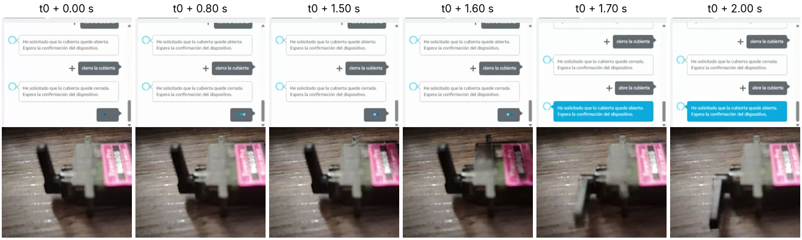

# Tiempo de respuesta de extremo a extremo con Alexa (RNF3)

**Fecha:** 10/11/2026, 14:31 (hora de Bolivia) · **Video:** [RNF3.webm](RNF3.webm) · **Mediciones:** [respuesta-alexa-20261110-1431.csv](respuesta-alexa-20261110-1431.csv)

## Objetivo

Requisito RNF3 del informe técnico (§1.3): el actuador debe reflejar una orden de la Skill en **≤ 3 s**, medido de extremo a extremo: Alexa → Lambda → Device Shadow → ESP32 → servo.

## Procedimiento

1. ESP32 con el programa final `tendedero_shadow` y la Skill vinculada al Thing físico `tendedero-inteligente`.
2. Llamada de Google Meet grabada: en pantalla se comparte el simulador de la Alexa Developer Console y, en la misma vista, la cámara apunta al brazo del servo MG90S.
3. Órdenes alternadas por texto en el simulador: «abre la cubierta» / «cierra la cubierta», unos 10 s entre cada una.
4. El video se analizó cuadro a cuadro (30 fps):
   - **t₀ (envío):** primer cuadro en que aparece la burbuja del mensaje enviado en el simulador.
   - **Posición final:** último cuadro con movimiento del brazo; desde el siguiente el brazo queda quieto en la nueva posición.
   - **Respuesta de Alexa:** cuadro en que se muestra el texto de respuesta («He solicitado que la cubierta quede…»).

## Resultados

| Orden | Comando | Envío → posición final (s) | Envío → respuesta de Alexa (s) | Lambda |
|---:|---|---:|---:|---|
| 0 | cierra la cubierta | 6,47 | 6,47 | Primera invocación tras inactividad (en frío) |
| 1 | abre la cubierta | 1,70 | 1,70 | Activa |
| 2 | cierra la cubierta | 1,67 | 1,77 | Activa |
| 3 | abre la cubierta | 1,80 | 1,77 | Activa |
| 4 | cierra la cubierta | 1,63 | 1,67 | Activa |
| 5 | abre la cubierta | 1,80 | 2,20 | Activa |
| 6 | cierra la cubierta | 1,77 | 1,70 | Activa |
| 7 | abre la cubierta | 1,67 | 1,60 | Activa |
| 8 | cierra la cubierta | 1,77 | 1,77 | Activa |
| 9 | abre la cubierta | 1,53 | 1,60 | Activa |
| 10 | cierra la cubierta | 1,70 | 1,60 | Activa |

| Indicador (órdenes 1–10) | Valor |
|---|---|
| Promedio envío → posición final | **1,70 s** |
| Mínimo / máximo | 1,53 s / **1,80 s** |
| Órdenes que superan 3 s | **0 de 10** |
| Promedio envío → respuesta de Alexa | 1,74 s (máximo 2,20 s) |

**Veredicto: cumple.** Las 10 órdenes con Lambda activa movieron el servo a su posición final en 1,80 s como máximo, con 1,2 s de margen sobre el objetivo de 3 s.

**Figura.** Orden 1 («abre la cubierta»), cuadro a cuadro: a t₀ + 1,6 s el brazo está girando y a t₀ + 1,7 s queda en la posición final, al mismo tiempo que el simulador muestra la respuesta.

## Observaciones

- **Primera orden tras inactividad (orden 0): 6,47 s.** Corresponde al arranque en frío de Lambda: la primera invocación después de un período sin uso carga el entorno y el ASK SDK. Coincide con lo registrado en CloudWatch el 7/11 (4045,84 ms de ejecución más 689,80 ms de inicialización). Desde la segunda orden el tiempo baja a 1,5–1,8 s. Se informa por separado porque no representa la operación continua, pero es la experiencia del usuario tras un rato sin usar la Skill (ver mitigación en el informe, §7).
- **El servo termina antes de que se vea la respuesta.** Lambda escribe `desired` en el Shadow antes de devolver la respuesta a Alexa, de modo que el delta llega al ESP32 mientras el simulador todavía muestra la animación de espera.
- **Incertidumbre.** La cámara del servo llega por Meet con cierto retardo de red respecto a la pantalla compartida, por lo que los tiempos medidos pueden estar ligeramente sobreestimados (resultado conservador). La resolución del análisis es de un cuadro (≈0,03 s).
- **Modalidad.** Entrada textual en el simulador, por la limitación de micrófono del entorno; el tiempo de reconocimiento de voz no está incluido.
